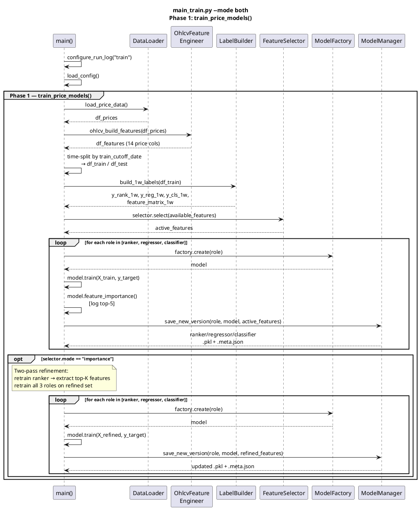
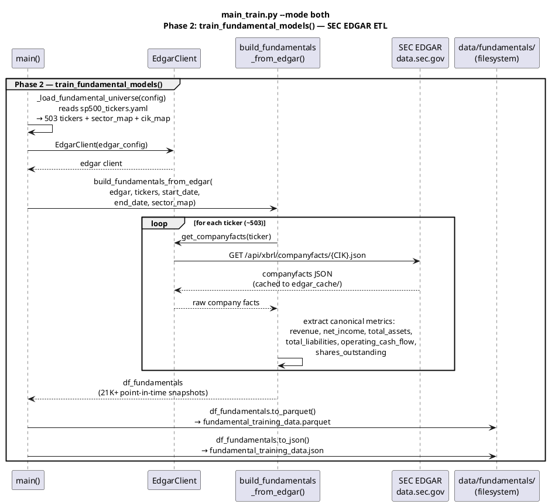
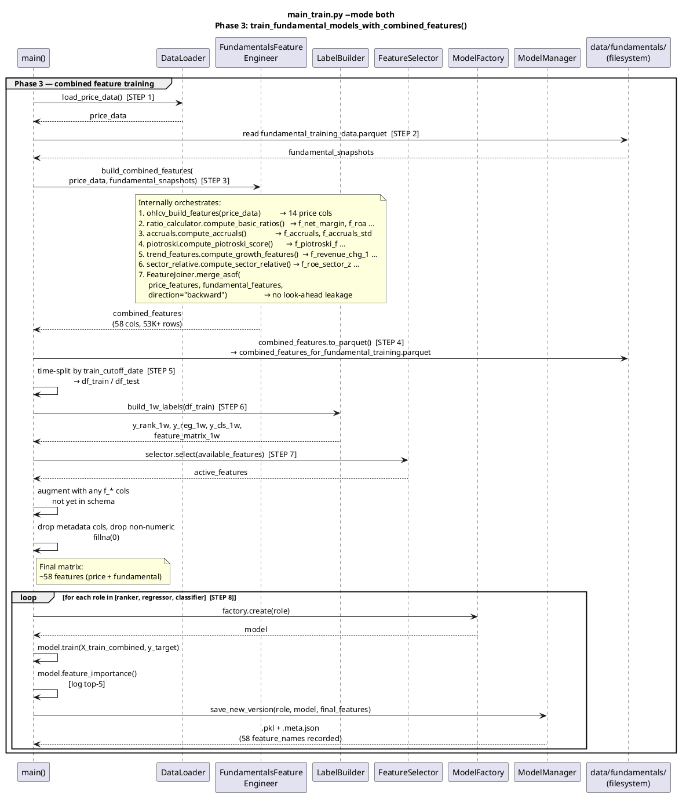
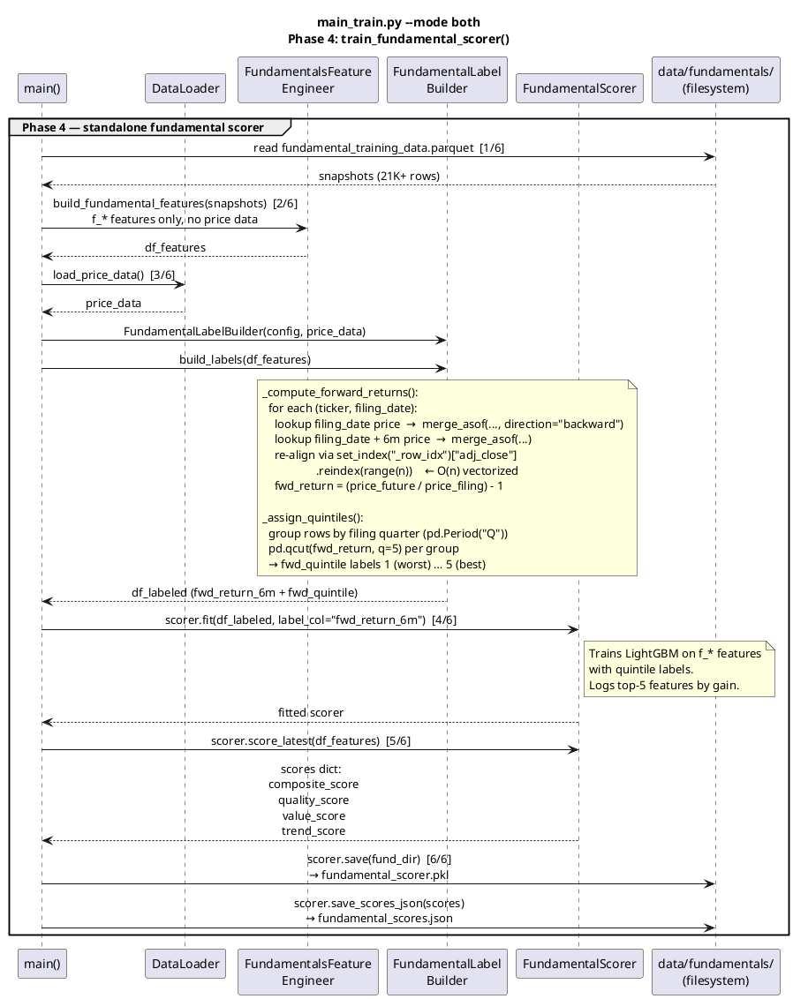

<!-- ARCHIVED — DO NOT CODE FROM THIS FILE -->

> **⚠️ ARCHIVED / HISTORICAL — NOT AUTHORITATIVE.** Frozen on 2026-08-08. This is a pre-SDD
> Release 1–5 document, kept as an immutable record of what was decided at the time. It does **not**
> describe the code today and it is **not** a set of instructions to execute. Paths inside predate the
> `notebooks/` → `sdd/` rename and are deliberately left unrewritten.
>
> **Authoritative sources:** `sdd/specs/vision.md` (what this project is) ·
> `sdd/specs/constitution.md` (the rules) · `sdd/specs/F<n>_<slug>/spec.md` (what a feature must do) ·
> `sdd/specs/F0_code_map/spec.md` (what the code currently looks like). See `sdd/archive/README.md`.

---

### Actual directory tree (as-built, rel-3)

```
ai-investment-pipeline
├── AI_stock_analysis                           ← parked LLM research report subproject
│   ├── .cognition/skills/stock-analysis/
│   │   └── SKILL.md
│   ├── .gitignore
│   ├── README.md
│   └── prompt_stock_analysis.md
├── config
│   ├── env.example                             ← NEW: documents required env vars (no secrets)
│   ├── env.yaml
│   ├── settings.yaml                           ← UPDATED: API keys replaced with ${VAR} placeholders; LSTM block removed
│   └── sp500_tickers.yaml
├── logs
│   ├── pipeline.log
│   ├── train_YYYY-MM-DD_HH-MM-SS.log           ← per-run dated log files (one per main_train.py run)
│   ├── wf_backtest_results.csv
│   └── wf_backtest_results_with_overlay.csv    ← UPDATED: now also written to timestamped run_dir
├── notebooks
│   ├── rel1_document.md
│   ├── rel1_improvement_strategy.md
│   ├── rel2_backtest_inference_logic.md
│   ├── rel2_document_fundamental_training_logic.md
│   ├── rel2_file_structure.md
│   ├── rel3_file_structure.md                  ← this file
│   └── rel3_intended_features_logics.md
├── pytest.ini                                  ← NEW: test discovery config (testpaths=tests, pythonpath=.)
├── reports
│   └── backtest_reports
│       ├── YYYY-MM-DD_HH-MM-SS/                ← NEW: each run gets its own timestamped subdirectory
│       │   ├── backtest_drawdown.png
│       │   ├── backtest_equity_curve.csv
│       │   ├── backtest_equity_curve.png
│       │   ├── backtest_metrics.csv
│       │   ├── backtest_recommendations_debug.csv
│       │   └── wf_backtest_results_with_overlay.csv
│       └── backtest_comparison.md
├── tests                                       ← NEW: integration test suite (25 tests, ~1.5s)
│   ├── conftest.py
│   ├── test_backtest_e2e.py
│   ├── test_feature_joiner.py
│   └── test_train_predict_cycle.py
└── pipeline
    ├── __init__.py
    ├── inspect_data.py
    ├── main_backtest.py                        ← UPDATED: timestamped run_dir, capital columns, --no-recompute-coeffs flag
    ├── main_inference.py
    ├── main_train.py
    ├── fundamental_analysis
    │   ├── __init__.py
    │   ├── data_providers
    │   │   ├── __init__.py
    │   │   └── fmp_client.py
    │   ├── etl
    │   │   ├── __init__.py
    │   │   ├── companyfacts_extractor.py
    │   │   ├── data_ingest_scheduler.py
    │   │   ├── edgar_client.py
    │   │   ├── etl_inspect.py
    │   │   ├── point_in_time.py
    │   │   ├── restatement_tracker.py
    │   │   ├── universe_manager.py
    │   │   └── xbrl_parser.py
    │   ├── features
    │   │   ├── __init__.py
    │   │   ├── accruals.py                     ← UPDATED (P4): vectorized, removed _accrual() row function
    │   │   ├── feature_schema_fundamental.yaml
    │   │   ├── fundamental_feature_engineer.py
    │   │   ├── piotroski.py
    │   │   ├── ratio_calculator.py             ← UPDATED (P4): fully rewritten, all .apply() replaced
    │   │   ├── sector_relative.py
    │   │   └── trend_features.py               ← UPDATED (P4): vectorized growth + rolling slope
    │   ├── integration
    │   │   ├── __init__.py
    │   │   └── overlay.py
    │   ├── models
    │   │   ├── __init__.py
    │   │   ├── fundamental_scorer.py
    │   │   └── label_builder.py                ← UPDATED (P4): O(n²) iterrows() → O(n) reindex()
    │   └── tests
    │       └── test_xbrl_parser.py
    ├── llm
    │   ├── __init__.py
    │   └── llm_analyst.py
    ├── ohlcv
    │   ├── __init__.py
    │   ├── backtest
    │   │   ├── __init__.py
    │   │   ├── backtester.py                   ← UPDATED: report() accepts output_dir parameter
    │   │   ├── backtest_report.py              ← UPDATED: __init__ accepts output_dir, creates timestamped dirs
    │   │   └── metrics.py
    │   ├── dataset
    │   │   ├── __init__.py
    │   │   ├── data_loader.py
    │   │   ├── feature_schema.py               ← UPDATED (P3): FUNDAMENTAL_FEATURES expanded 11→44 columns
    │   │   ├── feature_selector.py
    │   │   ├── label_builder.py
    │   │   └── ohlcv_feature_engineer.py
    │   ├── models
    │   │   ├── __init__.py
    │   │   ├── base_model.py
    │   │   ├── classifier_model.py
    │   │   ├── lightgbm_models.py
    │   │   ├── model_factory.py
    │   │   ├── model_manager.py
    │   │   ├── ranker_model.py
    │   │   ├── regressor_model.py
    │   │   ├── sklearn_models.py
    │   │   └── xgboost_models.py
    │   └── policy
    │       ├── __init__.py
    │       ├── _df_for_opt.pkl
    │       ├── policy_params.json
    │       └── slot_selector.py
    └── utils
        ├── __init__.py
        ├── logger.py
        └── utils.py                            ← UPDATED (P3): env var resolution in load_config()
```

---

### What changed from rel-2 to rel-3

| Area | Change | Detail |
|------|--------|--------|
| **Backtest reports** | Per-run timestamped directories | Every `main_backtest.py` run writes artifacts to `reports/backtest_reports/YYYY-MM-DD_HH-MM-SS/` |
| **WF CSV** | Dual-write | `wf_backtest_results_with_overlay.csv` written to both `logs/` and the run's timestamped dir |
| **WF table** | Capital columns added | Walk-forward per-fold table now shows `InitCap` and `FinalCap` |
| **CLI** | `--no-recompute-coeffs` flag | Replaces hardcoded `RECOMPUTE_COEFFS = True` constant in `main_backtest.py` |
| **API keys** | Env var resolution | `settings.yaml` uses `${ALPHA_VANTAGE_API_KEY}` etc.; `utils.py` resolves at load time |
| **Dead code** | LSTM block removed | `model.lstm` (8 lines) removed from `settings.yaml`; no model code used it |
| **Feature schema** | Expanded to 44 | `FUNDAMENTAL_FEATURES` in `feature_schema.py` updated from 11 → 44 real `f_*` columns |
| **Test suite** | 25 integration tests | New `tests/` directory with `pytest.ini`; covers train/predict cycle, backtest E2E, feature joiner |
| **Performance** | Vectorized fundamentals | All `.apply(axis=1)` removed from `ratio_calculator.py`, `accruals.py`, `trend_features.py` |
| **Performance** | O(n²) → O(n) lookup | `label_builder.py._asof_price_lookup()` re-aligned via `set_index().reindex()` |
| **Documentation** | `env.example` added | Documents required env vars with sign-up URLs; `.gitignore` excludes `.env` files |

---

### New files introduced in rel-3

**`config/env.example`**
Documents the three environment variables the pipeline requires: `ALPHA_VANTAGE_API_KEY`, `GOOGLE_API_KEY`, `NEWS_API_KEY`. Provides sign-up URLs and usage instructions. Never contains actual keys — acts as the template users copy to `.env`.

---

**`pytest.ini`**
Minimal pytest configuration at the project root. Sets `testpaths = tests` so `pytest` discovers only the integration suite without walking into `pipeline/`. Sets `pythonpath = .` so all `from pipeline.*` imports resolve without `sys.path` hacks.

---

**`tests/conftest.py`**
Session-scoped pytest fixtures shared across all 25 tests:

| Fixture | Scope | Purpose |
|---------|-------|---------|
| `cfg` | session | Minimal pipeline config dict (no file I/O required) |
| `price_df` | session | Synthetic 5-ticker × 100-day DataFrame with all 14 PRICE_FEATURES |
| `trained_models` | session | Pre-trained LightGBM ranker/regressor/classifier (trained once, reused) |
| `price_df_factory` | session | Returns `make_price_df(n_tickers, n_days, seed)` helper for custom shapes |

`make_price_df()` generates random-walk `adj_close` prices plus all OHLCV-derived features via `OhlcvFeatureEngineer`, producing a realistic synthetic DataFrame without external data dependencies.

---

**`tests/test_train_predict_cycle.py`** (7 tests)
Validates the train → predict lifecycle end-to-end with synthetic data. Confirms that `ModelFactory` creates all three roles, that predictions have correct shape and value ranges (ranker: positive floats, regressor: floats, classifier: [0,1] probabilities), and that models trained on one random seed generalize (produce predictions) on a different seed.

---

**`tests/test_backtest_e2e.py`** (12 tests)
Module-scoped fixture runs a full single-split backtest once; all 12 tests share the result. Verifies: all expected result keys present (`equity_curve`, `metrics`, `debug_log`), equity curve length invariant (`len == 30` for 30-day input), initial capital exactly `$20,000`, metric ranges (Sharpe > −5, max drawdown ∈ [0,1]), all 5 tickers present in the debug log.

---

**`tests/test_feature_joiner.py`** (6 tests)
Guards the correctness fixes from P0. Key tests:

- **`test_no_lookahead_leakage`** — injects a sentinel value (999.0) on a future filing date and asserts all rows before that date carry NaN, not the sentinel.
- **`test_ticker_column_not_duplicated`** — regression test for the P0 `ticker_x`/`ticker_y` bug: confirms the merged DataFrame has exactly one `ticker` column.
- **`test_backward_fill_between_two_filings`** — confirms that rows between two consecutive filings carry the earlier filing's value (forward-fill semantics).

---

### Purpose and changes to existing files

**`config/settings.yaml`**
Replaced three hardcoded API key strings with `${ALPHA_VANTAGE_API_KEY}`, `${GOOGLE_API_KEY}`, `${NEWS_API_KEY}`. Removed the `model.lstm` config block (8 lines) that had no corresponding implementation. Environment variable resolution happens in `utils.py:load_config()` before YAML parsing, so all downstream code is unchanged.

---

**`pipeline/utils/utils.py`**
Added `_resolve_env_vars(raw: str) -> str` using `re.sub()` to replace `${VAR}` patterns with `os.environ` values before passing the YAML string to `yaml.safe_load()`. Unset variables: leaves the placeholder in place and prints a stderr warning rather than crashing, enabling development without all keys set.

---

**`pipeline/ohlcv/dataset/feature_schema.py`**
`FUNDAMENTAL_FEATURES` expanded from 11 stub entries to the full 44 real `f_*` column names sourced from the actual `combined_features_for_fundamental_training.parquet` schema. Grouped into: profitability (11), leverage/solvency (4), liquidity (1), efficiency/size (4), valuation (1), accruals quality (2), Piotroski F-score (4), growth/trend (13), sector-relative z-scores (5). `ALL_FEATURES` is now 58 total (14 price + 44 fundamental).

---

**`pipeline/fundamental_analysis/features/ratio_calculator.py`**
Fully rewritten for vectorized performance. Added `_safe_div(numerator, denominator)` helper that replaces `0` denominators with `NaN` before division. All 20+ `.apply(lambda r: ..., axis=1)` calls replaced with direct pandas series arithmetic. Log transform uses `np.log(col.where(col > 0))`. Eliminates the per-row Python interpreter overhead that made this O(n) per ratio instead of vectorized.

---

**`pipeline/fundamental_analysis/features/accruals.py`**
Removed `_accrual(row)` inner function and its `.apply(axis=1)` call. Replaced with two lines: `lag = out["_lag_total_assets"].replace(0, np.nan)` followed by vectorized `(out["net_income"] - out["operating_cash_flow"]) / lag`. `f_accruals_std` already used `.transform()` and was untouched.

---

**`pipeline/fundamental_analysis/features/trend_features.py`**
Three functions vectorized:
- `compute_growth_features`: removed `_pct_change(row)` lambda; replaced with `lag = out[shift_name].replace(0, np.nan)` and `(out[col] - lag) / lag`.
- `compute_rolling_growth`: removed inline `lambda r: ...`; same vectorized pattern.
- `compute_margin_trend._rolling_slope`: replaced Python `for i in range(n)` loop with `pd.Series.rolling(window).apply(_slope, raw=True)`. The `x_centered` and `ss_x` OLS constants are pre-computed once outside the closure rather than re-computed per window.

---

**`pipeline/fundamental_analysis/models/label_builder.py`**
`_asof_price_lookup()` re-alignment loop replaced. The original `for _, row in merged.iterrows()` pattern was O(n²) because `merged.iterrows()` iterates every row while `.iloc[idx]` performs an index scan each time. Replaced with:
```python
price_by_idx = merged.dropna(subset=["adj_close"]).set_index("_row_idx")["adj_close"]
result = price_by_idx.reindex(range(len(lookup)))
result.index = lookup.index
```
This is O(n) — one hash-indexed lookup for all rows at once.

---

**`pipeline/ohlcv/backtest/backtest_report.py`**
`__init__` now accepts an optional `output_dir: Path` parameter. When provided, all artifacts (equity curve CSV/PNG, drawdown PNG, metrics CSV, debug CSV) are written to that directory instead of the default `reports/backtest_reports/`. Enables the run-directory isolation introduced in `main_backtest.py`.

---

**`pipeline/ohlcv/backtest/backtester.py`**
`report()` method gains an optional `output_dir: Path` parameter that it forwards to `BacktestReport.__init__()`.

---

**`pipeline/main_backtest.py`**
Four changes:
1. `main()` creates `run_dir = PROJECT_ROOT / "reports" / "backtest_reports" / datetime.now().strftime("%Y-%m-%d_%H-%M-%S")` before any processing, isolating all artifacts from the run.
2. `walk_forward_backtest()` gains `run_dir: Path = None` parameter and threads it through to `backtester.report()`.
3. Walk-forward per-fold table and CSV now include `initial_capital` and `final_capital` columns — captured at stitch time before the equity scaling is applied.
4. `--no-recompute-coeffs` CLI flag replaces the hardcoded `RECOMPUTE_COEFFS = True` module-level constant.

---

### Data files written at runtime

```
data/
├── current_positions.json              ← persisted portfolio positions (main_inference.py)
├── ohlcv/
│   └── price_data.parquet              ← consolidated OHLCV price history
├── raw/prices/
│   └── {TICKER}.parquet                ← per-ticker raw price downloads (yfinance)
└── fundamentals/
    ├── edgar_cache/                    ← raw SEC EDGAR company facts JSON (one file per ticker)
    │   └── companyfacts_{TICKER}_{CIK}.json
    ├── fundamental_training_data.parquet   ← canonical snapshots (--mode fundamental)
    ├── fundamental_training_data.json      ← JSON copy for inspection
    ├── combined_features_for_fundamental_training.parquet  ← OHLCV + f_* merged (--mode fundamental_full)
    ├── fundamental_scorer.pkl          ← trained FundamentalScorer (--mode fundamental_scorer)
    └── fundamental_scores.json         ← latest per-ticker quality/value/trend scores

trained_models/
├── version_registry.json
├── ranker/
│   ├── ranker_YYYY-MM-DD.pkl
│   └── ranker_YYYY-MM-DD.meta.json     ← feature_names + backend + timestamp
├── regressor/
│   └── (same structure)
└── classifier/
    └── (same structure)

reports/
└── backtest_reports/
    ├── backtest_comparison.md          ← manually maintained comparison across runs
    └── YYYY-MM-DD_HH-MM-SS/            ← one directory per backtest run
        ├── backtest_equity_curve.csv
        ├── backtest_equity_curve.png
        ├── backtest_drawdown.png
        ├── backtest_metrics.csv
        ├── backtest_recommendations_debug.csv
        └── wf_backtest_results_with_overlay.csv

logs/
├── pipeline.log
├── train_YYYY-MM-DD_HH-MM-SS.log       ← one log file per main_train.py run
├── wf_backtest_results.csv             ← legacy location (still written for backward compat)
└── wf_backtest_results_with_overlay.csv
```

---

### Sequence diagram — `main_train.py --mode both`

`--mode both` is the full end-to-end training pipeline. It runs four phases in sequence: price training, fundamental ETL, combined feature training, and standalone fundamental scorer training.

Each phase is a separate PlantUML diagram. Render with any PlantUML-compatible tool (VS Code PlantUML extension, IntelliJ, plantuml.com, or `plantuml -tpng`).

---

#### Phase 1 — `train_price_models()`



---

#### Phase 2 — `train_fundamental_models()` (SEC EDGAR ETL)



---

#### Phase 3 — `train_fundamental_models_with_combined_features()`



---

#### Phase 4 — `train_fundamental_scorer()`



---

### How the full pipeline integrates (inference path)

```
ModelManager.load_latest(role)         ← reads .pkl + .meta.json
    │
    ├── meta.json lists feature_names  ← determines if f_* cols needed
    │
    ▼
DataLoader.load_price_data()
OhlcvFeatureEngineer.ohlcv_build_features()   ← 14 price features
    │
    ├── if f_* required:
    │       read combined_features_for_fundamental_training.parquet
    │       left-join on (ticker, date)  ← 44 f_* columns added
    │
    ▼
ranker.predict() / regressor.predict() / classifier.predict_proba()
    │
SlotSelector.select()              ← LambdaRank scores → top-3 slots
    │
apply_fundamental_overlay()        ← overlay.py: DOWNGRADE removes position
    │
FundamentalScorer.score_latest()   ← quality/value/trend check
    │
LLMAnalyst.analyze_picks()         ← Gemini advisory commentary (advisory only)
    │
output: decisions + scores + annotations
```

---

### Not yet implemented (deferred from rel-3)

- `AI_stock_analysis` integration into the live inference path (P5) — subproject parked but auto-trigger from `main_inference.py` not yet wired
- `fundamental_analysis/sources/` — FRED macro client
- `fundamental_analysis/nlp/` — earnings transcript scraper, MD&A extractor, FinBERT
- `fundamental_analysis/scoring/altman_z.py` — Altman Z-Score
- SHAP explainability output alongside model artifacts
- Restatement-aware backtest re-runs
