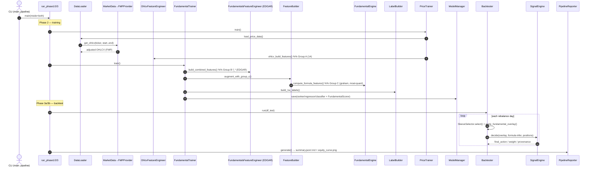
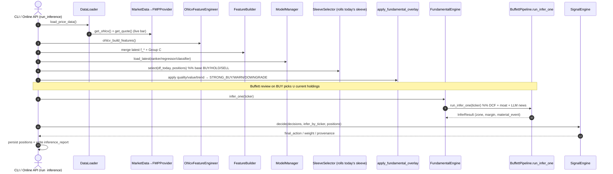
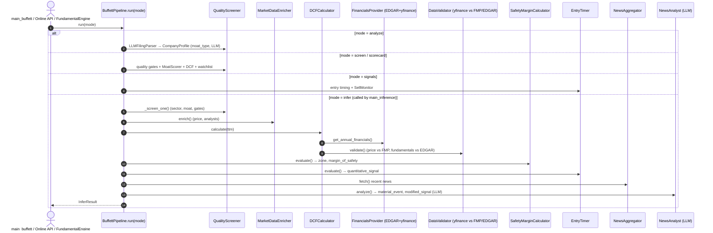

<!-- ARCHIVED — DO NOT CODE FROM THIS FILE -->

> **⚠️ ARCHIVED / HISTORICAL — NOT AUTHORITATIVE.** Frozen on 2026-08-08. This is a pre-SDD
> Release 1–5 document, kept as an immutable record of what was decided at the time. It does **not**
> describe the code today and it is **not** a set of instructions to execute. Paths inside predate the
> `notebooks/` → `sdd/` rename and are deliberately left unrewritten.
>
> **Authoritative sources:** `sdd/specs/vision.md` (what this project is) ·
> `sdd/specs/constitution.md` (the rules) · `sdd/specs/F<n>_<slug>/spec.md` (what a feature must do) ·
> `sdd/specs/F0_code_map/spec.md` (what the code currently looks like). See `sdd/archive/README.md`.

---

# Release 5 — As-Built Documentation

> The single source of truth for what Release 5 **actually implemented and
> tested**, how to use it, and how to extend it. The design spec
> (`notebooks/rel5_features.md`) was retired at release close (2026-07-03);
> its decision records that exist nowhere else are preserved verbatim-in-spirit
> in **Appendix D** at the end of this file — historical `rel5_features.md §…`
> references in the text below resolve there. The full 3-c model evaluation
> lives in its own companion: `notebooks/rel5_feature3c_all_model_evaluation.md`.

## Release 5 at a glance

| Feature | What it delivers | Implemented | Key outcome |
|---|---|---|---|
| **1 — Unified market data (FMP)** | One paid provider ($19.99/mo FMP Starter) behind a `MarketDataProvider` layer; fixes the corporate-actions cache-corruption bug (append-only merge) with full adjusted-history re-pull + split self-heal | 2026-06-05 | ~20 yr adjusted OHLCV + 10 yr fundamentals from one source; yfinance off the live path; Stooq demoted to cross-check |
| **2 — Fundamentals in training + inference** | Shared `pipeline/core` layer: 45 `f_*` + 2 Group-C Buffett-formula features in the training panel; `SignalEngine` veto/escalate overlay unifies the 3 old disconnected fundamental paths | 2026-06-06 | Fundamentals now shape both the models *and* the final action; NO LLM values in training (tokens + integrity) |
| **3-a — Model experimentation framework** | `ModelBundle` paradigms (separate/multihead/quantile/stacked/sequence) × 9 backends, prediction-quality metrics (RankIC/IC/AUC/NDCG), `--mode experiment` leaderboard | 2026-06-12 | Any model family comparable on identical data/metrics with one YAML |
| **3-b — Sleeve signal policy** | Daily top-1 from a soft-blended combined score; 5 overlapping weekday sleeves (Jegadeesh-Titman); incumbency-δ anti-whipsaw; honest weekly-lot Sharpe | 2026-06-18 | Holding period = label horizon; policy no longer confounds model evaluation |
| **3-c — Per-model tuning + production combined model** | CPCV (purged/embargoed) tuning of 9 families × 3 roles (25 sweeps, 426 fits) → mixed-backend production bundle: **RF ranker + ElasticNet regressor** (+ HistGB classifier, gate disabled) | 2026-06-20 → 07-02 | Walk-forward FULL Sharpe **0.871 vs 0.542 baseline (+61 %)**, CAGR 32 %/yr vs 10 %; fully reproducible (pinned seeds) |

**Release-close status (2026-07-03):** test suite fully green — **129 passed, 3
skipped** (live-API tests without `FMP_API_KEY`), 0 failures. Carried-over open
items are listed per feature ("Scope delivered vs remaining") and summarised in
Appendix D.6.

---

## Codebase capability review + file structure (release-5 close)

What the pipeline can do today, entrypoint by entrypoint, and where everything
lives. This is the orientation section for anyone (human or agent) resuming
work on this repo.

### Directory map

```
pipeline/
  main_pipeline.py       # train + backtest CLI (phases 1-4, --mode …)
  main_inference.py      # daily live signals CLI
  main_buffett.py        # fundamental-first (DCF/moat/news) engine CLI
  data_providers/        # Feature 1: MarketDataProvider ABC, FMPProvider,
                         #   StooqOHLCVProvider, ohlcv_assembler, MarketData facade
  core/                  # Feature 2 shared layer: feature_builder (Group C),
                         #   fundamental_engine, signal_engine (veto/escalate + soft blend)
  ohlcv/                 # the price-ML paradigm
    dataset/             #   DataLoader, feature engineering, LabelBuilder,
                         #   feature_schema (ALL_FEATURES=59), FeatureSelector,
                         #   FeatureSelectionPipeline (per-fold Option-B selection)
    models/              #   BaseModel roles, ModelFactory (per-role backends),
                         #   ModelBundle paradigms, 9 backend wrappers, ModelManager
    experiments/         #   Feature 3-a/3-c: runner, CPCV, grid_gen,
                         #   tuning_report, leaderboard
    policy/              #   SleeveSelector (THE selector: blend + top-1 sleeve roll;
                         #   legacy SlotSelector removed 2026-07-04), policy_params.json
    backtest/            #   Backtester (5 staggered weekly buckets), metrics
    training/            #   TrainingPipeline (per-fold: validate→select→train→optimise)
    eval/                #   prediction_metrics (IC/RankIC/NDCG/AUC/Brier)
    reports/             #   PipelineReporter (pipeline_summary.md + business metrics)
  training/              # PriceTrainer / FundamentalTrainer (Phase-2 wrappers)
  fundamental_analysis/  # FundamentalsFeatureEngineer (f_* ratios, Piotroski,
                         #   accruals, trends, sector-z), FundamentalScorer, EDGAR ETL
  buffett/               # DCF/moat/quality engine, screening, news, EDGAR filings,
                         #   DataValidator (integrity harness), synthesis reports
  api/                   # Online API — FastAPI web UI (laptop/phone via Tailscale)
  llm/                   # LLM client (inference-time gates only, never training)
  utils/                 # logger, PROJECT_ROOT helpers
config/
  settings.yaml          # THE config: universe (123 tickers), production models
                         #   (per-role backends + tuned hyperparameters), allocation,
                         #   signal_engine, market_data
  universe_balanced.yaml # the 123-name sector-balanced S&P500 universe
  sp500_tickers.yaml     # curated S&P500 (506 names + CIKs) for future breadth
  experiments.yaml       # 3-a variant matrix (full hyperparameter reference block)
  tuning/*.yaml          # 3-c sweep configs (25 per-family-role + production_combined)
data/                    # parquet caches: ohlcv/, fundamentals/ (panels)
trained_models/          # ModelManager production registry (role-versioned .pkl+meta)
reports/                 # git-ignored EXCEPT the Rel5_Experiment archive (below)
  experiments/<ts>/      # leaderboards + §3c.9 tuning reports (self-describing)
  experiments/Rel5_Experiment/   # ★ COMMITTED archive of ALL release-5 experiment
                         #   evidence (25 A+B sweeps, winners run, console logs) —
                         #   the .gitignore carves this one folder back in
  backtest_reports/<ts>/ # pipeline runs: data_quality/ training/ backtests + summary
tests/                   # 129-test suite (see per-feature sections)
notebooks/               # this doc + rel5_feature3c_all_model_evaluation.md + rel6_features.md
pipeline/ohlcv/experiments/run_feature3c.py   # sweep orchestrator: --group A|B|prod
```

### What each entrypoint can do

**`python -m pipeline.main_pipeline`** — training + backtest.
- `--mode price` — train OHLCV-only models (14 price features) + Phases 3a/3b.
- `--mode fundamental` — fundamental ETL → combined 61-feature panel →
  production model training (+ scorer) + backtests.
- `--mode both` — the full run: Phase 1 data quality → Phase 2 (price then
  combined training; the combined models are what Phases 3a/3b consume) →
  Phase 3a single-split backtest → Phase 3b walk-forward (Option B: per-fold
  validation, feature selection, training, coefficient optimisation) → Phase 4
  `pipeline_summary.md` with investor-view business metrics + equity curve.
- `--mode experiment --experiments <yaml>` — a 3-a/3-c sweep (walk-forward or
  CPCV per the YAML) → `reports/experiments/<ts>/`.
- `--mode optimize_thresholds` — grid-search the overlay/δ thresholds.
- Key flags: `--fundamental-overlay`, `--skip-etl`, `--wf-fold-years/…-val-years/…-workers`.

**`python -m pipeline.ohlcv.experiments.run_feature3c --group prod|A|B`**
(from the repo root) — orchestrates
tuning sweeps in sequence + the cross-model `tuned_winners.md` roll-up. Groups
A/B (the 25-family sweeps) are **frozen** post-verdict; `prod` re-validates the
production combined bundle + RF/Linear/HistGB references + the stacked ensemble
(~1 h).

**`python -m pipeline.main_inference`** — daily signals: loads latest
production models, merges each ticker's latest fundamentals, scores the
123-name cross-section, blends `0.65·z(rank) + 0.35·z(ret) + 0.00·z(prob)`,
applies the SignalEngine overlay (with `--fundamental-overlay`), prints ranked
actions. **Prices are ALWAYS live FMP quotes** (2026-07-07 decision): during
market hours a live spot bar is appended; off-hours the previous trading day's
close (the series' last real bar) is used — no synthetic bar is fabricated,
so return features stay honest. `--live-price` is a deprecated no-op;
`--date` replays a day (never receives a live bar).
**Live = backtest policy since 2026-07-04:** the run rolls TODAY'S weekday
sleeve through `SleeveSelector` and persists the 5-sleeve state in
`data/sleeve_positions.json` (see Feature 3-b §7).

**`python -m pipeline.main_buffett --mode …`** — the fundamental-first engine:
`analyze | screen | signals | report | scorecard | infer | synthesis-report |
backtest | full`. Feeds Group-C features + the SignalEngine gates; `infer` is
also called by `main_inference` on top-K candidates (LLM news materiality,
cached).

**Online API** (`pipeline/api/app.py`, FastAPI, served over Tailscale) — web UI
for laptop/phone: run inference (incl. live-price INFERENCE action), view
reports/scorecards. See the "Online API" section below.

### Production configuration (as of release close)

- **Universe:** 123 sector-balanced S&P 500 names (`pipeline.tickers`).
- **Models** (`models.backend`, per-role): `ranker: sklearn_rf` (500 trees,
  depth 8, sqrt features), `regressor: linear` (ElasticNet α=0.01 l1=0.1),
  `classifier: sklearn` (HistGB — trained but **gated off**:
  `allocation.prob_hurdle: 0.0`, blend weight 0). All `random_state: 42`.
- **Blend:** `policy_params.json = {rank: 0.65, return: 0.35, prob: 0.0}` —
  independently re-confirmed by the fold-8 Sharpe grid-search.
- **Data:** 343k-row combined panel (96 cols), 2015→2026, NaN-native training
  (`feature_2.fillna_zero: false`); fastparquet engine everywhere (pyarrow
  crashes on these files).
- **Headline validated performance:** walk-forward 2018→2026 FULL Sharpe 0.871,
  CAGR 32.1 %/yr, MaxDD −52.1 % (fold-1/2018 concentration risk — the binding
  constraint for rel6).

---

## Feature 1 — Unified market-data provider (FMP) · IMPLEMENTED

### 1. What changed and why

The pipeline previously stitched together many free sources (yfinance, NewsAPI,
a 5-way news fan-out, Stooq-for-price, FMP free tier). The headline defect was
**corporate-actions corruption**: `DataLoader` fetched yfinance with
`auto_adjust=False` and merged new bars **append-only**, so a stock split
re-based history at the vendor but only the trailing rows were overwritten —
leaving the cached series silently inconsistent (`rel5_features.md §1.1.1`).

Feature 1 introduces a single paid source (**FMP Starter, $19.99/mo**) behind a
**unified provider layer**, and replaces the append-only OHLCV path with a
**full re-pull of split-adjusted history** that self-heals on new splits.

### 2. Key empirical findings (live Starter key, 2026-06-05)

These corrected two assumptions in the design spec:

1. **FMP Starter serves ~20 years of split-adjusted OHLCV**, not 5. The
   `/stable/historical-price-eod/full` endpoint returns up to **5000 daily bars**
   when an early `from` date is passed; the "5-year limit" is only the *default*
   when `from` is omitted. Quarterly fundamentals return **~10 years (40 rows)**.
   → **Stooq is no longer needed for history.** The Stooq splice/ratio-matching
   layer (design §1.8.4) was **dropped**. Stooq remains only as an optional
   cross-check/fallback (and is presently behind a JS anti-bot wall).
2. **FMP legacy `/api/v3/` endpoints are retired** for keys created after
   2025-08-31. The build uses **`/stable/` exclusively**. The two pre-existing
   FMP clients (`fmp_client`, `consensus_fetcher`) were on dead v3 endpoints but
   are **not on any active runtime path**; they were converted to thin delegates.

`close` from `/stable/.../full` is already split-adjusted, so the provider sets
`adj_close = close`. Verified: NVDA's 2024-06-10 **10:1 split shows no
discontinuity** (120.89 → 121.79); max |daily return| over NVDA's full history is
0.30 (a real earnings move, not a split artifact).

### 3. New code — provider layer (`pipeline/data_providers/`)

| Module | Class | Responsibility |
|--------|-------|----------------|
| `base.py` | `MarketDataProvider` (ABC) | The contract every consumer depends on: `get_ohlcv / get_fundamentals / get_news / get_consensus / get_profile / get_quote / get_splits`. |
| `fmp_provider.py` | `FMPProvider` | Full `/stable/` implementation + per-ticker parquet cache, throttle (300/min), **OHLCV full-rebuild with split self-heal**, in-memory splits memo. |
| `stooq_provider.py` | `StooqProvider` | Free full-history daily CSV (US). Cross-check/fallback only; guards against the JS anti-bot HTML response. |
| `market_data.py` | `MarketData` | Source-selecting facade (`source: fmp \| stooq \| legacy_yfinance`); FMP→Stooq fallback on empty OHLCV; exposes `cross_check` for the integrity harness. |

**Contract return shapes**
- `get_ohlcv` → `date, ticker, open, high, low, close, adj_close, volume` (adjusted).
- `get_fundamentals` → canonical `ticker, filing_date, period_end, revenue,
  net_income, total_assets, total_liabilities, operating_cash_flow,
  shares_outstanding` (PIT via `filing_date`/`period_end`).
- `get_news` → `title, source, published_at (ISO/UTC), url, summary`.
- `get_consensus` → `forward_eps, forward_revenue, num_analysts,
  price_target_avg/high/low/median, estimate_date`.
- `get_splits` → `date, ratio` (numerator/denominator).

**Corporate-actions correctness (the R1 fix), in `FMPProvider.get_ohlcv`:**
1. Always fetch from a fixed `history_floor` (default 1990-01-01) so the cache
   holds the **maximum** series; the requested `[start, end]` is a slice. (Fixes
   an order-dependent cache bug where a prior short request capped later long
   ones.)
2. **Never append** — every refresh rebuilds the full adjusted series.
3. **Split self-heal:** a sidecar `{TICKER}_ohlcv.meta.json` records
   `last_split_seen`; if `get_splits` shows a newer split than the cache, the
   cache is invalidated and rebuilt.

Cache lives in `data/market_data/fmp_cache/` (OHLCV TTL 18h, fundamentals 168h).

### 4. Rewired consumers

| File | Change |
|------|--------|
| `pipeline/ohlcv/dataset/data_loader.py` | New `fetch_via_market_data()` + branch in `load_or_fetch_all_raw()`. When `market_data.source ∈ {fmp, stooq}` (default **fmp**), OHLCV is a **full re-pull** over `[start_date, end_date]` and the raw parquet is **overwritten** (append-only merge deleted from this path). `legacy_yfinance` keeps the old behaviour for A/B. Also fixed a latent bug: `load_price_data()` persisted `data/ohlcv/price_data.parquet` only `if not exists`, letting a stale snapshot shadow fresh data and desync the fundamental labels — now **always overwrites**. |
| `pipeline/buffett/etl/consensus_fetcher.py` | Now a thin delegate over `FMPProvider.get_consensus` (`/stable/`). Public `fetch_estimates` signature + keys unchanged. |
| `pipeline/fundamental_analysis/data_providers/fmp_client.py` | `build_fundamentals_for_ticker` now delegates to `FMPProvider.get_fundamentals` (`/stable/`); legacy v3 statement fetchers retained only for reference. |

### 5. Config (`config/settings.yaml`) + `.env`

- `fmp.api_key` → `"${FMP_API_KEY}"` (was a literal placeholder).
- New `market_data:` block — `source`, `fmp` (base URL, rate limit, cache TTLs,
  `max_history_rows`), `stooq` (cross-check/fallback).
- **`.env` must be sourced before running** (the repo expands `${VAR}` from the
  environment, no dotenv autoload): `set -a; source .env; set +a`.
  `FMPProvider` also falls back to `os.environ["FMP_API_KEY"]` if the config
  value is an unexpanded `${...}`.

### 6. Tests (`tests/test_marketdata_integrity.py`)

The corporate-actions acceptance suite from design §1.6. Skips cleanly when
`FMP_API_KEY` is absent.

| Test | Asserts | Result |
|------|---------|--------|
| `test_no_split_discontinuity[NVDA 10:1]` | no ~90% jump across split date | ✅ pass |
| `test_no_split_discontinuity[AAPL 4:1]` | no ~75% jump across split date | ✅ pass |
| `test_full_history_depth` | ≥10yr of OHLCV (MSFT) | ✅ pass |
| `test_fmp_stooq_overlap_agrees` | FMP↔Stooq adj close median diff <2% | ⏭ skip (Stooq JS-walled) |

Full suite: **3 passed, 1 skipped**. Existing suite: **65 passed**, plus **3
pre-existing failures** in `test_data_validator.py` (`_ttm_from_quarterly_entries`)
that are **unrelated to Feature 1** — confirmed by re-running with the Feature-1
changes stashed.

### 7. How to use

```bash
set -a; source .env; set +a            # load FMP_API_KEY
python3 -m pytest tests/test_marketdata_integrity.py -v

# Training/inference now pull adjusted OHLCV via FMP automatically
python3 -m pipeline.main_pipeline --mode price
python3 -m pipeline.main_inference
```
A/B back to the old path: set `market_data.source: legacy_yfinance` in
`settings.yaml`.

### 8. Scope delivered vs. remaining (within Feature 1)

**Delivered + tested:** provider layer; corporate-actions-correct OHLCV
(the core R1 fix); DataLoader rewire (training/inference price path); FMP
fundamentals + news + consensus + profile + quote + splits; config + `.env`
wiring; legacy v3 clients de-fanged to `/stable/`; integrity test suite.

**Remaining Buffett-side rewiring** (updated at rel5 close):
1. ~~`news_aggregator.py`~~ — **DONE 2026-07-06**: the 5-way free fan-out
   (Finnhub/Marketaux/NewsData/AlphaVantage sources) was removed;
   `NewsAggregator` is now **FMP-first** via `MarketData.get_news`, with
   Yahoo RSS kept only as a keyless fallback when FMP returns nothing.
   `NewsItem` + dedupe/age helpers unchanged. (Root cause of the phone
   showing all-Yahoo headlines: the free keys were deprecated in Feature 1,
   leaving keyless YahooRSS as the only live source in the old fan-out.)
2. ~~yfinance in the Buffett pipeline~~ — **DONE 2026-07-05 (the "A4" fix):
   yfinance is fully removed from `pipeline/buffett/`.** All price AND
   fundamental/context data now comes from FMP via `MarketData`:
   - `technical_analyzer` (OHLCV + **beta from FMP profile**), `entry_timer`
     (OHLCV + **FMP `/stable/earnings` calendar**), `backtest/pit_data`
     (full ~20-yr adjusted history), `backtest/iv_replay`
     (`_fmp_sector_provider`), `filing_monitor` (next-earnings via FMP),
     `financials_provider` (price/sector/shares/mktCap via FMP profile;
     EDGAR kept for the statement snapshots = ground truth),
     `market_data_enricher` (TTM statements = sum of last 4 FMP quarters,
     analyst targets, rating changes, insider trades, dividends, news).
   - New `FMPProvider`/`MarketData` methods (all live-verified on the Starter
     key): `get_next_earnings_date`, `get_ttm_financials`, `get_dividends`,
     `get_grades`, `get_insider_trades`; `get_profile` now returns `beta` +
     `last_dividend`. **Not on Starter:** institutional-ownership (404) —
     `EnrichedMarketData.institutional_top5` is now always empty.
   - yfinance survives ONLY behind the `market_data.source: legacy_yfinance`
     A/B switch in `DataLoader` (scheduled for removal, P6).
3. `data_validator.py` → repurpose to the sampled integrity harness with
   **EDGAR** as ground truth (design §1.6); the Stooq price cross-check there is
   currently broken by the JS wall and should move to EDGAR/FMP. *(open)*
4. `dcf_calculator.py` → remove the inline `DataValidator` BLOCK gate. *(open)*

### 9. Notes / gotchas for the next implementer

- FMP OHLCV `from` matters: omit it and you get ~5yr; pass an early date for full
  history. `FMPProvider` always passes `history_floor` internally.
- `MarketData.cross_check` returns the Stooq provider for QA; Stooq currently
  serves a JS challenge from automated IPs — prefer EDGAR for cross-checks.
- Canada is deferred (US-only scope). Symbol handling is suffix-agnostic, so
  `.TO` tickers will route through FMP later without code change.

---

## Feature 2 — Fundamentals in training + inference · IMPLEMENTED

> Implemented 2026-06-06. Design: `rel5_features.md §2`. Combines the three
> entrypoints via a **shared layered core** so fundamentals affect signals in
> **both** training (formula features) and inference (veto+escalate gates).

### 1. What changed and why

Previously fundamentals reached signals three disconnected ways: `f_*` model
features (training), the overlay STRONG_BUY/WARN/DOWNGRADE (inference), and the
Buffett `run_infer_one` review — which was **advisory only** (printed, never fed
back). Feature 2 unifies them behind `pipeline/core/` and promotes the Buffett
layer to a real **gate**: it can now force SELL/TRIM on a held name (material
negative event, deeply negative margin of safety) and escalate strong confluence
to STRONG_BUY — but **never originate a buy** (price-led, fundamental safety net).

### 2. New code — shared core (`pipeline/core/`)

| Module | Class | Role |
|--------|-------|------|
| `signal_engine.py` | `SignalEngine` | Layer 3. `decide(decisions, infer_by_ticker, current_positions)` → adds `final_action / final_weight / provenance`. Pure function (same logic for live + backtest). |
| `fundamental_engine.py` | `FundamentalEngine` | `compute_formula_features(funds, prices)` → Group C (training, formula-only, PIT); `infer_one(ticker)` → Buffett `InferResult` (inference gates). |
| `feature_builder.py` | `FeatureBuilder` | Layer 1. `augment_with_group_c(panel, funds, prices)` → PIT `merge_asof` of Group C onto the combined panel (additive, never breaks training). |

### 3. Combined training features (all formula — NO LLM, no tokens)

Source of truth: `feature_schema.py`. The 59 existing features (`PRICE_FEATURES`
14 + `FUNDAMENTAL_FEATURES` 45) were already formula-only; Feature 2 adds:

| New feature | Formula | Notes |
|-------------|---------|-------|
| `f_graham_number_ratio` | √(22.5·EPS·BVPS) ÷ price − 1 | EPS, BVPS from panel; price at filing date (PIT) |
| `f_moat_quant_score` | panel-native quant moat in [0,1]: ROA level + stability + revenue-growth consistency (trailing 8q) | mirrors `MoatScorer` quant intent; **LLM part excluded** |

`ALL_FEATURES_V2 = PRICE_FEATURES + FUNDAMENTAL_FEATURES + GROUP_C_FEATURES`
(61). The trainer auto-includes any `f_*` column (`fundamental_trainer.py:273`),
so Group C enters the model with no extra wiring; inference picks the same
columns from the combined parquet.

**Excluded from training (LLM, inference-gate only):** `moat_score` (hybrid
0.6·quant+0.4·llm), `moat_type`, news materiality (`material_event`, `direction`,
`modified_signal`, `reason`). `f_dcf_margin_of_safety` is **also not a training
feature** — the owner-earnings DCF uses latest financials and is not historically
PIT-reconstructable; it is an inference-time SignalEngine gate via `InferResult`.

### 4. SignalEngine reconciliation (veto + escalate) — `decide()` precedence

1. **Risk veto** (acts on held names): material negative event → **SELL**;
   margin-of-safety ≤ `margin_of_safety_floor` → **TRIM** (held) / block buy (new).
2. ML **SELL**/**HOLD** pass through (never upgraded).
3. Weak quality gates (< `min_quality_gates` of 4) → block buy → **HOLD**.
4. **Escalate**: ML BUY + overlay STRONG_BUY + Buffett BUY-zone/positive margin
   → **STRONG_BUY** + size-up (×`escalate_size_multiplier`, capped).
5. Else base BUY stands. Fundamentals **never** turn a non-BUY into a BUY.

Every row carries `provenance` (which rule fired) for backtest attribution.
Thresholds in `config/settings.yaml → signal_engine:`.

### 5. Rewired entrypoint

`pipeline/main_inference.py` — steps 6–7 replaced: runs the Buffett review on
**BUY candidates ∪ current holdings** (so vetoes can hit held names; cached LLM),
builds `infer_by_ticker`, calls `SignalEngine.decide(...)`, prints
`=== Final Signals (SignalEngine) ===` with provenance, and **persists positions
off `final_action`/`final_weight`** (not the advisory pre-fusion action).

`pipeline/training/fundamental_trainer.py` — new STEP 3a augments the combined
panel with Group C via `FeatureBuilder`, gated by `feature_2.enable_group_c`
(default true), wrapped so a failure logs a warning and training continues.

### 6. Tests

`tests/test_signal_engine.py` — 9 deterministic policy tests (no network):
BUY only ML-originated, fundamentals never originate, material-negative→SELL on
held, overpriced→TRIM/block, confluence→STRONG_BUY (+capped size-up), weak gates
→HOLD, overlay DOWNGRADE→HOLD, ML SELL never upgraded. **9/9 pass.**
Group C + PIT merge smoke-tested on live AAPL/MSFT (moat 0.70–0.79, 99% non-null).
Full suite: **74 passed, 1 skipped** (+ 3 pre-existing unrelated `data_validator`
TTM failures).

### 7. How to run

```bash
set -a; source .env; set +a
# Train (Group C added automatically when feature_2.enable_group_c=true)
python3 -m pipeline.main_pipeline --mode both
# Inference — fundamentals now drive the FINAL action via SignalEngine
python3 -m pipeline.main_inference --fundamental-overlay
```
Inference log now ends with `=== Final Signals (SignalEngine) ===` showing
`final_action | final_weight | provenance` per name.

### 8. Important notes

- **`f_dcf_margin_of_safety` is a gate, not a feature** (see §3) — by design, to
  avoid train/inference skew on a non-PIT quantity.
- **Veto scope:** the Buffett review (and its cached LLM call) now runs on held
  names too — bounded by portfolio size + filing-aware cache, but it is more LLM
  calls than the old top-3-only advisory loop.
- **`enable_group_c` is safe to toggle:** off → exactly the pre-Feature-2 58-feature
  model; on → 60 features. A failure in Group C never breaks training (panel
  returned unchanged).
- **Backtest parity (DONE 2026-06-06):** `Backtester` now fuses through
  `SignalEngine` when the overlay is on (`signal_engine.enable_in_backtest`,
  default true). In backtest the gate inputs are **formula-only / PIT**
  (`_formula_infer`: 4 Buffett-style quality gates from `f_roic/f_debt_to_equity/
  f_fcf/f_current_ratio` + STRONG_BUY escalation); the **DCF-margin and LLM
  materiality vetoes stay live-only** (no clean historical source, §2.7).
  Verified firing on 2024-2026 (quality vetoes + escalations active); effect is
  intentionally mild vs live.

### 9. Reporting fixes (2026-06-06)

- **Single-split metrics bug fixed:** `PipelineReporter._read_phase3a` now parses
  the **long-format** `metric,value` CSV (it previously assumed wide → reported
  Sharpe/return as 0.0). Phase 3b was unaffected (wide format).
- **Business-metrics block** added to `pipeline_summary.json` + `.md` by default:
  money-in, money-out, profit/loss, duration, annual return (overall + **per
  year** for walk-forward), worst peak-to-bottom drawdown, Sharpe — for both the
  single-split and walk-forward tests.
- **`equity_curve.png` auto-generated** every backtest run (single-split vs
  walk-forward, embedded in the markdown report).
- Note: the combined-features parquet currently must be read with
  `engine="fastparquet"` (default pyarrow can throw a histogram-mismatch on it).
- Group C in training currently sources fundamentals from the **EDGAR** snapshot
  panel (same as `f_*`); it populates because that schema carries
  `net_income/total_assets/total_liabilities/shares_outstanding/revenue`.

---

## Feature 3-a — Model experimentation framework · IMPLEMENTED 2026-06-12

> Design + decisions in `rel5_features.md` §3a (win metric = **RankIC first,
> Sharpe tiebreak**, §3a.0; full scope incl. deep + sequence models). This is
> the as-built record. Feature 3-b (signal policy) is NOT started.

### 1. What changed and why

The pipeline could only ever run **one** model setup (3 LightGBM models hard-
wired into `Backtester`/`TrainingPipeline`). Feature 3-a makes the model layer
swappable and measurable so variants can compete on evidence:

- **`ModelBundle` seam** — `Backtester` no longer assumes "exactly three
  models"; anything that emits `rank_score / pred_return / prob_up` plugs in.
  The legacy `(ranker, regressor, classifier)` constructor still works (wrapped
  via `SeparateModelsBundle.from_models`; equality locked by test).
- **Prediction-quality metrics** — before, only portfolio metrics existed
  (Sharpe/DD). Now raw signal skill is measured per day, out-of-sample:
  RankIC ± ICIR, IC, NDCG@3 (quintile-bin gains), Precision@3, top-bottom
  quantile spread, AUC/Brier.
- **ExperimentRunner + leaderboard** — one YAML describes a variant matrix
  (paradigm × backend × hyperparameters); each variant trains/evaluates on the
  **same** walk-forward folds, same frozen selector coefficients, same
  feature panel (loaded once) → `reports/experiments/<ts>/leaderboard.{md,csv}`
  + `run_meta.json` (seeds + library versions).

### 2. New code

```
pipeline/ohlcv/eval/prediction_metrics.py     PredictionMetrics (per-day cross-sectional)
pipeline/ohlcv/models/model_bundle.py         ModelBundle ABC + SeparateModels/Quantile/
                                              Stacked/MultiHead/Sequence bundles
pipeline/ohlcv/models/bundle_factory.py       build_bundle(spec) — paradigm dispatch
pipeline/ohlcv/models/linear_models.py        backend "linear"  (ElasticNet/Logistic floor)
pipeline/ohlcv/models/catboost_models.py      backend "catboost" (sector = native categorical)
pipeline/ohlcv/models/torch_utils.py          shared torch plumbing (impute/scale, fit loop,
                                              CPU-state pickling, MultiHeadMLP)
pipeline/ohlcv/models/ft_transformer.py       backend "ft_transformer" (Gorishniy 2021)
pipeline/ohlcv/models/tabm_models.py          backend "tabm" (TabM-mini ensemble MLP)
pipeline/ohlcv/models/sequence_model.py       SequenceModel ABC + LSTMSequenceModel
                                              (lookback windows + static fundamentals)
pipeline/ohlcv/experiments/                   experiment_config / experiment_runner / leaderboard
config/experiments.yaml                       the 9-variant default matrix
tests/test_model_bundle.py                    6 unit tests (incl. triple==bundle equity parity)
```

Modified: `backtester.py` (predicts through `self.bundle`; df_day keeps
date/ticker so bundles needing them work), `model_factory.py` (registers the
4 new backends, all lazy/optional imports), `main_pipeline.py` (`--mode
experiment`, `--experiments`).

### 3. Paradigms × backends available

| Paradigm (`paradigm:`) | Meaning | Score mapping |
|---|---|---|
| `separate` (P0, baseline) | 3 independent models | direct |
| `multihead` (P1) | one shared-trunk MLP, 3 heads | direct (torch) |
| `quantile` (P3) | P10/P50/P90 LightGBM | `pred=P50`; `prob_up = P(ret>thr)`, σ=(P90−P10)/2.5631 |
| `stacked` (P4) | blend of child variants | z-score mean; prob = plain mean |
| `sequence` (Phase 6) | LSTM over 60-day price window + static `f_*` | direct; <lookback history ⇒ prob 0 (never picked) |

Backends for `separate`: `lightgbm` (default) · `xgboost` · `sklearn(_rf)` ·
`linear` · `catboost` · `ft_transformer` · `tabm`. (P2 rank-only was dropped —
`rel5_features.md` §3a.3.)

### 4. PyTorch / `tf_gpu` environment setup (one-time)

The NN backends (`ft_transformer`, `tabm`, `multihead`, `sequence`) need PyTorch
+ CUDA; CatBoost needs `catboost`. Both live in the **`tf_gpu`** conda env
(Python 3.10). This was already installed 2026-06-12 — these are the exact steps
to **reproduce or verify** on this or another machine.

```bash
# 0. Activate the env (NEVER pip-install torch into base — see §6 cu129 note)
conda activate tf_gpu

# 1. Verify what's already there (skip installs if these print versions)
python -c "import torch; print('torch', torch.__version__, '| cuda:', torch.cuda.is_available())"
python -c "import catboost; print('catboost', catboost.__version__)"

# 2. (Re)install only if missing.  cu129 is REQUIRED, not cu128:
#    tf_gpu's Keras 3 stack pins pip nvidia-*-cu12 == 12.9 libraries, and a
#    cu128 torch wheel downgrades them and can break Keras/TF.  cu129 only ADDS.
pip install catboost
pip install torch --index-url https://download.pytorch.org/whl/cu129

# 3. Confirm the GPU is actually visible (expect: NVIDIA GeForce RTX 5060 Ti)
python -c "import torch; print(torch.cuda.get_device_name(0) if torch.cuda.is_available() else 'CPU only')"

# 4. Confirm Keras still imports (regression check after touching CUDA libs)
python -c "import keras; print('keras', keras.__version__)"
```

Notes:
- **Driver CUDA 13.0 on this box** runs the cu129 runtime fine (driver ≥ toolkit).
- If `torch.cuda.is_available()` is **False**, the NN backends silently fall back
  to **CPU** (`device = "cuda" if torch.cuda.is_available() else "cpu"`) — slower
  but correct; nothing crashes.
- **base env (Python 3.13)** has lightgbm/xgboost/sklearn/catboost but **no
  torch** — run only CPU/tabular variants there; torch variants show **SKIPPED**.

### 5. How to run

```bash
conda activate tf_gpu          # the env with torch 2.11.0+cu129 + catboost
cd ~/Workspace/ai-investment-pipeline
set -a; source .env; set +a

# Full sweep (9 variants × ~8 walk-forward folds — hours, GPU used by NN variants)
python -m pipeline.main_pipeline --mode experiment

# Custom matrix / quick run
python -m pipeline.main_pipeline --mode experiment --experiments my_experiments.yaml
```

- Output: `reports/experiments/<timestamp>/leaderboard.md` (+ `.csv`,
  `run_meta.json`). Sorted by **RankIC desc, Sharpe tiebreak** (§3a.0).
- Quick sweeps: set `max_folds: 1` (and lower NN `epochs`) in the YAML.
- Variant knobs: `enabled: false` disables; missing backend (e.g. torch absent
  in base env) ⇒ row status **SKIPPED**, never fatal; an exception in one
  variant ⇒ **FAILED** row, sweep continues.
- Prerequisite: the combined panel from `--mode fundamental` must exist
  (`data/fundamentals/combined_features_for_fundamental_training.parquet`).
- GPU monitor (optional, separate terminal): `watch -n1 nvidia-smi`.

### 6. Verification status (2026-06-12)

- Smoke-tested end-to-end on the real panel (74,663 rows × 30 tickers,
  2015–2026) in **both** envs: 5 CPU variants (base + tf_gpu, identical
  LightGBM numbers ⇒ deterministic seeding) and 4 torch variants on the RTX
  5060 Ti (FT-Transformer ×2, TabM, LSTM sequence — all CUDA-confirmed).
- `tests/test_model_bundle.py` 6/6 green; full suite: 71 passed + 3
  **pre-existing** `test_data_validator.py` TTM failures (untouched module,
  not from this work).
- ⚠ **Smoke runs only (1 fold, low epochs) — the production leaderboard run
  of the full `config/experiments.yaml` has NOT been executed yet.** Numbers
  seen so far are machinery checks, not model verdicts.

### 7. Notes / gotchas

- **Env split:** torch was installed into **`tf_gpu`** as **cu129** (not
  cu128) on purpose — the env's Keras 3 stack pins pip NVIDIA CUDA-12.9 libs
  and cu128 would have downgraded them. Keras verified intact post-install.
  `base` (Py 3.13) has catboost but no torch → torch variants SKIP there.
- **Frozen coefficients:** experiments never run
  `SleeveSelector.optimize_coefficients` (fairness + runtime, §3a.9.4) — they use
  `policy_params.json` as-is. Re-optimise only for the chosen winner.
- **Fixed feature set per sweep** (`features:` in the YAML — `ALL_FEATURES` by
  default, `ALL_FEATURES_V2` adds Group C). Per-variant feature *selection* is
  deliberately not part of experiments; production training keeps it.
- **`sector` handling:** auto-appended only for `backend: catboost` variants
  (string column would crash the numeric backends).
- All experiment artifacts stay under `reports/experiments/` — the production
  `trained_models/` registry is never touched by a sweep.
- **Full hyperparameter surface (2026-06-19).** `config/experiments.yaml` is now
  the single source of truth for tuning: every per-variant model hyperparameter
  is listed explicitly at its current code default (full menu for all backends —
  lightgbm/xgboost/sklearn/sklearn_rf/linear/catboost/ft_transformer/tabm/
  multihead/quantile/sequence — in the REFERENCE block at the top of the file).
  Change a value and re-run; nothing else to touch. Two wiring additions make
  this honest: (1) an experiment-level **`config_overrides:`** block is
  deep-merged into `settings.yaml` for the sweep, so label/eval knobs outside
  per-variant hyperparameters (`costs.cls_threshold_bps`, `allocation.max_slots`
  = K for NDCG@K/Precision@K) are tunable from the same file; (2) **`QuantileBundle`
  quantiles are now configurable** (`hyperparameters.quantiles: [lo, mid, hi]`,
  default P10/P50/P90; the prob_up σ-divisor is derived from the chosen outer
  quantiles). Seeds are intentionally NOT listed — the runner assigns
  `experiment.seed + variant_index` per variant and records it. Verified by
  `tests/test_experiment_hyperparams.py`.
- **Config recorded into every run (2026-06-19).** Each
  `reports/experiments/<ts>/` now captures exactly what was run, for future
  reference: (a) **`experiments_used.yaml`** — a verbatim copy of the input
  config; (b) **`run_meta.json`** — now also carries `config_overrides`,
  `label_horizon`, `max_folds`, and **`variant_configs`** = the *effective*
  per-variant hyperparameters incl. the runner-injected per-variant seed
  (correct seed key per backend: `seed`/`random_state`/`random_seed`); (c) a
  **"Model configurations used"** section in `leaderboard.md` (overrides JSON +
  per-variant table). So a leaderboard is always self-describing — no need to
  guess which YAML produced it.

---

## Feature 3-b — Signal policy: daily top-1, overlapping weekly sleeves · IMPLEMENTED 2026-06-18

> Design + decisions in `rel5_features.md §3b` (policy = **1 stock/day, 5
> independent weekday sleeves, held ~1 week**; final pick = **top-1 of a soft
> blend**; **incumbency margin δ**; transaction cost **not charged in the
> backtest** — but the cost model of record is a **FIXED $20 round-trip
> ($10 buy + $10 sell), Victor's actual broker cost**, never a bps model;
> judge *models* on 3-a RankIC, judge *the system* on this funnel backtest).
> This is the as-built record.

### 0. Glossary — what a "sleeve" is, and SlotSelector vs SleeveSelector

**Sleeve.** A *sleeve* is an independent sub-portfolio tied to one weekday.
The capital is split into 5 equal sleeves — Monday-sleeve … Friday-sleeve.
Each sleeve holds exactly **one stock for one week**, then "rolls" on its own
weekday: the fresh daily top-1 challenges the incumbent and replaces it only
if it wins by the margin δ. Because the five weekly clocks are staggered, on
any given day the account holds up to 5 names, but each individual position
is a clean 5-trading-day bet — exactly the horizon the model was trained to
predict (`fwd_ret_1w`). The term comes from asset management, where a "sleeve"
is a separately-managed slice of one portfolio; academically this is the
Jegadeesh-Titman (1993) overlapping holding-period construction. In code, a
sleeve = one of the `Backtester`'s 5 staggered weekly buckets (`horizon_days=5`,
bucket `i % 5` rebalances each successive trading day).

**`SleeveSelector`** (`pipeline/ohlcv/policy/sleeve_selector.py`) — **the one
and only selector** since 2026-07-04. Its job, each day: z-score the three
model outputs across the universe, blend them into one **opportunity score**
(`0.65·z(rank) + 0.35·z(ret) + 0.00·z(prob)`, weights Sharpe-optimised in
`policy_params.json`), subtract a turnover penalty for names that would
displace a holding, soft-blend in any fundamental / technical score via
`SignalEngine.combined_score`, take the **top-1** name, and apply the
**incumbency challenge** — the challenger must beat the held name's current
score by δ (`incumbency_margin_delta: 0.05`) — benchmarked against cash (weak
days → hold cash). It also owns `optimize_coefficients` (the Sharpe
grid-search of the blend weights). The weekly hold/roll mechanics live outside
the selector: in the `Backtester`'s 5 staggered buckets (backtest) and in
`main_inference`'s persisted `data/sleeve_positions.json` (live, §7).

**`SlotSelector` (historical, REMOVED 2026-07-04).** The original pre-3-b
policy engine: same blend, but it filled up to **3 concurrent "slots"**
re-decided **every day** — which meant the realised holding period (~1 day)
never matched the model's 5-day label, and daily re-deciding churned real
$20-a-round-trip money. Superseded by the sleeve policy; at release close its
shared machinery (blend, optimizer, penalties) was merged into
`SleeveSelector` and the class was deleted so exactly **one selector** exists.
The `Backtester`'s `policy: legacy_slots` branch (and the `backtest.policy`
knob) was removed with it — the sleeve path is the only path, and it retains
the fee machinery (`charge_transaction_cost` + the flat $10/trade
`_reconcile_bucket`).

| | `SlotSelector` (removed) | `SleeveSelector` (the policy, backtest **and** live) |
|---|---|---|
| Positions | up to 3 slots, re-decided daily | 1 per sleeve × 5 sleeves, weekly roll |
| Holding period | ~1 day (churny) | 5 trading days = the label horizon |
| Pick rule | top-`max_slots` of blend | top-1 of blend + δ-challenge + cash gate |
| Anti-churn | swap buffer | incumbency margin δ (0.05) |
| State | positions dict | positions + per-sleeve roll clock (persisted live) |

### 1. What changed and why

The pre-3b policy held ≤3 names with **daily churn**, so the realised holding
period (≈1 day) did not match the model's **5-day-forward label** — the result
depended on which day you rebalanced and the tuned slot/blend coefficients
confounded model evaluation (`rel5_features.md §3b.1`). Feature 3-b replaces it
with the academic **overlapping holding-period portfolio** (Jegadeesh-Titman
1993): each weekday opens its own **1-name lot held for one week**, then rolls.

The key realisation is that the existing `Backtester` **already had the sleeve
scaffold**: it runs `horizon_days=5` staggered buckets and rebalances bucket
`i % 5` on each successive trading day — i.e. each bucket *is* a weekday sleeve
that rolls every 5 trading days. Feature 3-b therefore (a) sets **1 name per
sleeve**, (b) selects that name from a **soft-blended combined score**, and
(c) adds an **incumbency-δ challenge** so a noisy top-1 does not flip-flop the
holding week to week. Because buckets are indexed in **trading days** (not
calendar weekdays), the §3b.4 holiday special-case does not arise in backtest
(holidays are simply absent rows) — the design's "count holds in trading days"
alternative is what the scaffold already does.

### 2. New code

| Module | Class / method | Role |
|--------|----------------|------|
| `pipeline/core/signal_engine.py` | `SignalEngine.combined_score(df)` *(new)* | The **soft blend** (§3b.7). Where `decide()` *gates*, this *scores*: z-scores each present component (`ohlcv_score`, `fundamental_composite`, `technical_score`), blends by `signal_engine.blend` weights **renormalised over present components**, → one rankable `combined_score`. Missing fundamental ⇒ neutral (z=0), not dropped; closes the §3b.8 "blend extension" open item. |
| `pipeline/ohlcv/policy/sleeve_selector.py` | `SleeveSelector` *(new; standalone since 2026-07-04 — absorbed the retired `SlotSelector`)* | Top-1 picker for one sleeve: `max_slots = 1`, reuses the parent OHLCV opportunity blend (`compute_opportunity`) as `ohlcv_score`, calls `combined_score`, then applies the **incumbency-δ challenge** (`_resolve_incumbency`): challenger replaces incumbent only if `challenger_score − incumbent_current_score > δ`; no challenger ⇒ keep incumbent if it still beats cash, else sell to cash (§3b.3/§3b.4). |

Modified: `pipeline/ohlcv/backtest/backtester.py`:
- ~~Reads `backtest.policy` (`sleeve` | `legacy_slots`)~~ — the policy knob and
  the legacy branch were **removed at rel5 close (2026-07-04, §7)**: sleeve is
  the only path. It **auto-wraps** any duck-typed selector into a
  `SleeveSelector` (carrying its coefficients), so the phases need no change.
- `policy == sleeve` path (`_sleeve_targets` + `_record_and_reconcile_sleeve`):
  annotates the day with `fundamental_composite` from the loaded scores, takes
  the sleeve's top-1, and rolls **one** bucket — **bypassing** the legacy
  overlay/DOWNGRADE/`SignalEngine.decide` multi-slot path (fundamentals now
  enter via the blend, not a separate gate).
- **Transaction cost** (§3b.5): a new `charge_transaction_cost` flag (default
  **false** under `sleeve`, **true** under legacy) gates the fee subtraction in
  `run()`. `_reconcile_bucket` still *computes* the flat $10 fee, so
  `tests/test_flat_trade_fee.py` is untouched — only whether `run()` subtracts it
  changes.
- **Weekly-lot metrics** (§3b.6): `PortfolioBucket.last_rebalance_capital` tracks
  each sleeve's growth between rolls; `_weekly_metrics` reports
  `weekly_sharpe / weekly_return_mean / weekly_return_std / n_weekly_lots` over
  these **non-overlapping** observations (annualised ×√52) — the honest Sharpe,
  since the 5 overlapping sleeves make a naïve daily Sharpe×√252 inflated.

### 3. Config (`config/settings.yaml`)

```yaml
signal_engine:
  blend:                 # §3b.7 soft blend — renormalised over present components
    ohlcv: 1.0
    fundamental: 0.5
    technical: 0.0       # wire up when a technical/entry-timing score is exposed

backtest:
  # (backtest.policy knob removed 2026-07-04 — sleeve is the only policy)
  charge_transaction_cost: false   # §3b.5 — $20 round-trip immaterial at realistic capital
  weekly_observation: true         # §3b.6 — non-overlapping weekly-lot Sharpe

allocation:
  incumbency_margin_delta: 0.05    # §3b.3 — δ; 0 ⇒ always hold the current weekly top-1
```

### 4. Tests (`tests/test_sleeve_policy.py`)

11 deterministic tests (no network): `combined_score` blend (ohlcv-only,
fundamental lift, graceful degrade, missing-score-is-neutral); `SleeveSelector`
(max_slots=1, top-1 when empty, incumbency keeps within δ / swaps beyond δ, no-
challenger keep-vs-cash); a mini end-to-end sleeve backtest (weekly metrics
present, ≤1 name selected per sleeve roll). **All pass.** Full suite after
3-b: **88 passed, 3 skipped** + the **3 pre-existing** `test_data_validator.py`
TTM failures (untouched module, unrelated — same baseline as Features 1/2/3-a).

### 5. How to run

```bash
set -a; source .env; set +a
# Sleeve policy is the default in settings.yaml → Phase 3a/3b use it automatically.
python3 -m pipeline.main_pipeline --mode both --fundamental-overlay
# Phase 3a/3b metric CSVs now include weekly_sharpe / n_weekly_lots.
```

### 6. Scope delivered vs. remaining

**Delivered + tested:** soft-blend `combined_score`; `SleeveSelector` (top-1 +
incumbency δ); Backtester sleeve policy (1 name/sleeve, ≤5 concurrent, cost
toggle, non-overlapping weekly-lot Sharpe); config; test suite. (The
legacy_slots A/B switch shipped with 3-b was removed at rel5 close —
sleeve is the only policy.)

**Remaining (consistent with `rel5_features.md §3b.8` open items):**
1. ~~**Live execution parity**~~ — **DONE 2026-07-04** (§7 below): live
   inference now rolls the day's weekday sleeve through `SleeveSelector` with
   the 5-lot state persisted in `data/sleeve_positions.json`; the legacy
   `SlotSelector` was removed entirely.
2. **δ / blend-weight tuning** — `optimize_thresholds` runs against the sleeve
   policy now, but δ and the ohlcv/fundamental/technical blend weights ship at
   conservative defaults; tune once the universe widens.
3. **Technical component** — `blend.technical` defaults to 0 until an entry-
   timing score is surfaced onto the day's panel.
4. **Denoising / attribution check** (§3b.7) — compare blended top-1 vs OHLCV-
   only top-1 vs OHLCV top-5 equal-weight on weekly Sharpe to confirm the
   filters add skill rather than just removing diversification.

### 7. Live sleeve state + SlotSelector removal · IMPLEMENTED 2026-07-04

Closes the §6-item-1 gap: **live inference now runs the exact policy the
walk-forward validated** (FULL Sharpe 0.871). One selector, one policy,
backtest = live.

**How the live roll works** (`main_inference.run_inference`, step 3/7):

1. `data/sleeve_positions.json` persists the 5 lots:
   `{"0": {"ticker","weight","entered"} | null, … "4"}` (Mon=0 … Fri=4;
   weights are **sleeve-relative** — 1.0 = the whole 1/5-of-capital sleeve).
2. The trading date's weekday names **today's sleeve**; only that sleeve rolls:
   its incumbent (if any) is passed to `SleeveSelector.select`, which applies
   the incumbency-δ challenge exactly as in backtest. Weekend dates roll
   nothing.
3. The other four sleeves surface as HOLD rows so the overlay / Buffett review /
   `SignalEngine` can still **veto any held name** (forced SELL empties that
   sleeve; TRIM keeps it at `weight × trim_fraction` — the SignalEngine's
   account-capped `final_weight` is deliberately NOT stored back into a
   sleeve).
4. `_update_sleeves` folds the FINAL actions back into the state (a retained
   incumbent keeps its original `entered` date); the flat aggregate
   (`{ticker: lots/5}`) still lands in `data/current_positions.json` for the
   report and Online API.
5. Re-running the same day is **idempotent** (incumbent == challenger ⇒ hold).

**Migration:** on first run the sleeves start empty (a warning is logged if
legacy flat positions exist) and fill naturally over the first week — or edit
`data/sleeve_positions.json` by hand to seed your real holdings.

**SlotSelector removed — completely.** The legacy ≤3-slot daily policy is
gone; its shared machinery (opportunity blend, `optimize_coefficients`,
turnover penalty, coefficient persistence) was merged into a now-standalone
`SleeveSelector` (`slot_selector.py` deleted; all callsites — trainers,
`TrainingPipeline`, `ExperimentRunner`, `main_pipeline`, tests — rewired). In
a second pass the `Backtester`'s `legacy_slots` branch was excised too: the
`backtest.policy` knob is gone (sleeve is THE policy), along with the
legacy-only `_fill_downgraded_slots`/`_formula_infer` helpers and their tests.
The fee machinery survives on the sleeve path (`charge_transaction_cost:
true` charges the broker-real flat $10/trade in `_reconcile_bucket`,
guarded by `tests/test_flat_trade_fee.py`).

**Tests:** `tests/test_live_sleeve_state.py` (8 tests — new-buy entry dates,
incumbent-roll date preservation, cash/veto emptying, TRIM semantics, flat
aggregation); suite 137 passed.

---

## Feature 3-c — Per-model hyperparameter tuning + production combined model · IMPLEMENTED 2026-06-20 → 2026-07-01

> Full analysis with methodology, per-variant records and investment framing:
> **`notebooks/rel5_feature3c_all_model_evaluation.md`** (the consolidated
> report; supersedes the four interim notes in `reports/experiments/`).

### 1. What was done and why

Tuned **9 model families × 3 roles** (25 sweeps, 426 config×role fits) under
CPCV (N=6, k=2 → 15 splits / 5 paths, purge + 5-day embargo) on the 123-name
sector-balanced universe, then promoted the winners into a **production
combined bundle**. Verdict: **RandomForest ranker** (RankIC 0.0257, ICIR
0.123) + **ElasticNet regressor** (IC 0.0342, path-σ 0.0007); classifier has
no skill anywhere (AUC ≈ 0.51) so its gate is disabled; LightGBM/XGBoost
ranking objectives collapsed (proven objective-class problem, not a bug);
deep models (FT-Transformer/TabM/LSTM) never beat the forest at ~100× cost.
No family cleared the RankICIR ≥ 0.30 gate — edge is real but marginal.

### 2. New code (experiment infrastructure, built 2026-06-20)

- `pipeline/ohlcv/experiments/cpcv.py` — CPCV splits/purge/embargo/path
  reconstruction (López de Prado).
- `pipeline/ohlcv/experiments/tuning_report.py` — §3c.9 tuning_report.md/json,
  `select_winner` (gate → σ-penalty → keep-default-within-1σ),
  `rollup_tuned_winners` (P3 cross-model table).
- `pipeline/ohlcv/experiments/grid_gen.py` — compact spec → 25
  `config/tuning/*.yaml` sweep files (`grid` | `random(N)`).
- Runner/config: `validation.scheme: cpcv`, `selection:` block,
  `train_only_selected_role` (~3× lossless speed-up for role sweeps),
  P2 regressor metrics (`pred_reg_*`), GPU telemetry.
- Fixes en route: `sklearn_gb` → **HistGradientBoosting** (NaN-native, the
  classic GB crashed on the 96%-NaN panel); `_filter_params` kwarg-leak guard;
  honest `ran_on_gpu`.

### 3. New code (production combined model, §9 of the report — 2026-07-01)

- **`ModelFactory` per-role backends** (`model_factory.py`):
  `models.backend` now accepts a mapping `{ranker, regressor, classifier}` in
  addition to a single string. `backend_for(role)` exposed;
  `backend_name == "mixed"` for mappings. Both the training pipeline and the
  experiment runner build through this factory, so one change covers both.
- **Runner support for mixed variants** (`experiment_runner.py`): dict-aware
  backend availability check, per-role seed-key injection in `_with_seed`,
  compact `mixed(ran=…,reg=…,cla=…)` leaderboard label.
- **`VariantSpec.backend`** widened to `str | dict | None`
  (`experiment_config.py`).
- **`config/tuning/production_combined.yaml`** — the §9 validation sweep:
  `prod_rf_lin` (the production bundle, default) vs `rf_pure` / `lin_pure` /
  `histgb_pure` references + `ens_rf_lin_gb` (stacked z-blend of the three
  pointwise survivors, §10 item 3). Same CPCV protocol, selected on RankIC.
- **Tests:** `tests/test_production_bundle.py` (8 tests — factory mapping,
  mixed bundle end-to-end train/predict, per-role seeding, label).

### 4. Config changes (`config/settings.yaml` + policy)

- `models.backend:` → `{ranker: sklearn_rf, regressor: linear, classifier:
  sklearn}`; `models.hyperparameters` = the CPCV-tuned winners (report
  Appendix B): RF `n_estimators=500, max_features=sqrt, min_samples_leaf=20,
  max_depth=8`; ElasticNet `alpha=0.01, l1_ratio=0.1`; HistGB cls
  `max_depth=5, lr=0.1, max_leaf_nodes=31`.
- `allocation.prob_hurdle*: 0.55 → 0.0` — classifier gate DISABLED (a veto
  with AUC ≈ 0.51 only costs opportunity). Restore after the cls label rework.
- `pipeline/ohlcv/policy/policy_params.json` blend → `{rank: 0.65, return:
  0.35, prob: 0.0}` (the Sharpe-optimised 0.55/0.30 renormalised without the
  skill-less prob term; `optimize_coefficients` can re-derive).
- **★ Raw evidence archived + committed: `reports/experiments/Rel5_Experiment/`**
  — `Initial_Finetune_Experiement/` (all 25 Group-A/B sweep report dirs by
  timestamp + `tuned_winners.md` + full console logs) and
  `Winners_Model_Experiment/` (the production-combined validation run
  `2026-07-01_21-51-01` + logs). This is the only tracked content under
  `reports/` (see the layered negation block at the END of `.gitignore` — it
  must stay last to out-rank the generic `logs/`/`*.pkl` patterns). If these
  raw artifacts are ever lost, the key numbers survive in
  `notebooks/rel5_feature3c_all_model_evaluation.md`.
- `pipeline/ohlcv/experiments/run_feature3c.py` (moved into the experiments
  package at release close; was Workspace root) gains `--group prod`;
  **Groups A/B are frozen** for
  routine use (§9 item 4) — re-run only on material data/feature/label change.

### ★ Decision record — why the classifier is benched (`prob_hurdle 0.0`, blend weight 0.0) — RE-EVALUATE EVERY RELEASE

> **For the future AI-agent:** the third model head (classifier / `prob_up`)
> currently has **zero influence** on decisions. This was an evidence-based
> demotion, not a design principle. Every future release that changes labels,
> features, or models MUST re-evaluate the 3-head combination — and the
> classifier should regain weight the moment it earns it (criteria below).

**What is set where:**
- `config/settings.yaml` → `allocation.prob_hurdle: 0.0` (the hard eligibility
  gate, was 0.55);
- `pipeline/ohlcv/policy/policy_params.json` → `{"rank": 0.65, "return": 0.35,
  "prob": 0.0}` (the opportunity-blend weights).

**Evidence chain (all raw reports archived under
`reports/experiments/Rel5_Experiment/Initial_Finetune_Experiement/reports/`):**

1. **Every classifier, in every family, is a coin flip.** CPCV AUC of the best
   variant per family (0.50 = zero skill; each row = one archived sweep dir,
   see its `tuning_report.json`):

   | Family | best AUC | sweep dir |
   |---|---|---|
   | HistGB | 0.5190 | `2026-06-26_23-02-34` |
   | RandomForest | 0.5163 | `2026-06-25_07-49-06` |
   | XGBoost | 0.5148 | `2026-06-24_11-50-18` |
   | Linear | 0.5138 | `2026-06-26_10-44-11` |
   | TabM | 0.5123 | `2026-06-29_19-34-36` |
   | FT-Transformer | 0.5114 | `2026-06-28_18-58-13` |
   | CatBoost | 0.5089 | `2026-06-24_16-41-57` |
   | LightGBM | 0.5065 | `2026-06-24_07-32-58` |

   A hard gate driven by a ~0.51-AUC probability filters candidates almost at
   random — it can only *cost* opportunity, never add skill. Hence report §9
   item 3 (`rel5_feature3c_all_model_evaluation.md`): gate disabled, blend
   renormalised from the Sharpe-optimised 0.55/0.30/0.15 to 0.65/0.35/0.00.
2. **The Sharpe optimizer independently reached the same verdict.** In the
   walk-forward run (fold 8, 2026-07-02), `optimize_coefficients` grid-searched
   blend triples **with prob allowed up to 0.20** — and converged on exactly
   `rank 0.65 / return 0.35 / prob 0.00` (persisted in `policy_params.json`;
   run analysed in the "Feature 3-c backtest" section below). Money agreed
   with AUC.
3. **The cost of the old gate, measured:** the pre-experiment baseline
   (`2026-06-23_22-32-05`, hurdle 0.55 + LightGBM classifier) sat **in cash
   87 % of days** — its flattering −8.5 % drawdown was mostly "never
   invested", and 4 of its 8 walk-forward folds returned exactly 0.0 %.

**How the classifier regains weight (any of):**
- **Label rework** — the current binary `fwd_ret > cls_threshold` label is too
  noisy. Try a dead-band (label only "clearly up" vs "clearly down", drop the
  mushy middle) or a forward-return-quantile target, then re-run the 3-c
  classifier sweeps (§13.4 of the evaluation doc) and check AUC.
- **Replace it with the D.4 meta-label validator** — P(the BUY is correct |
  fundamentals, regime) — which answers a more learnable question than raw
  direction.
- **Bar to clear:** sustained CPCV **AUC ≳ 0.53 with a calibrated Brier**, AND
  the fold-level Sharpe optimizer assigning `prob > 0` **on its own** when the
  grid allows it. Never hand-restore the weight without both.

### 5. How to run

```bash
# Validate the production combined model under the identical 3-c protocol:
python -m pipeline.ohlcv.experiments.run_feature3c --group prod
#   — or directly —
python -m pipeline.main_pipeline --mode experiment \
    --experiments config/tuning/production_combined.yaml

# Normal training/backtest now builds the mixed bundle automatically
# (settings.yaml models.backend is the per-role mapping):
python -m pipeline.main_pipeline --mode both
```

### 6. Scope delivered vs. remaining

**Delivered:** full 25-sweep tuning corpus (Groups A+B, 100 % OK after fixes);
consolidated report; mixed-backend production bundle wired into settings;
classifier gate disabled; production validation sweep + ensemble variant;
8 new tests (131 total green, 3 pre-existing TTM failures unrelated).

**Remaining (report §10):** breadth → full S&P 500 (needs ETL re-run);
cross-sectional/fundamental feature work; classifier label rework (dead-band)
then re-enable hurdle; top-k sleeve diversification; paper-trade tracking of
live RankIC vs the 0.026 backtest before sizing up.

---

## Feature 3-c backtest — production combined model, full pipeline · RUN 2026-07-02 (complete)

> Run: `reports/backtest_reports/2026-07-02_23-36-06/` —
> `--mode both --fundamental-overlay --skip-etl`, production bundle
> (RF ranker + ElasticNet regressor + HistGB classifier, tuned Appendix-B
> configs), 61 features (59 ALL_FEATURES + 2 Group-C), blend 0.65/0.35/0.00,
> classifier gate OFF, 123-name universe.
> Baseline: `2026-06-23_22-32-05/` — pre-experiment run (LightGBM all roles,
> no overlay, `prob_hurdle 0.55`), same windows.
> Supersedes the 2026-07-01_23-35-40 run, whose walk-forward silently
> produced nothing (bug post-mortem in §4 below — both fixes verified here).

### 1. Phase 3a single-split (2023-01 → 2026-04, 833 trading days)

| Metric | Baseline (LightGBM, gate 0.55) | **Combined model (gate off)** |
|---|---|---|
| Total return ($20k in) | +59.1% → $31,820 | **+288.5% → $77,704** |
| CAGR | 15.1%/yr | **50.7%/yr** |
| Sharpe (daily / weekly-lot) | 1.26 / 0.857 | 1.14 / **0.896** |
| Max drawdown / ann. vol | −8.5% / 11.7% | −42.3% / 44.7% |
| Days in market | **13.3%** | **99.9%** |

Byte-identical to the 07-01 run (`random_state: 42` pin) — **the production
stack is now fully reproducible.** Interpretation unchanged: risk-adjusted
skill is the same or slightly better; the transformation is **deployment**
(the baseline sat in cash 87% of days behind the skill-less classifier
gate), traded for genuine equity volatility.

### 2. Phase 3b walk-forward — the honest test (8 folds, 2018-03 → 2026-03)

Expanding-window Option B: each fold re-runs validation + per-fold feature
selection + training + coefficient optimisation, then backtests the next
unseen year. **All 8 folds completed** (previous run: 0).

**FULL stitched result vs baseline:**

| Metric (FULL 2018→2026) | Baseline | **Combined model** |
|---|---|---|
| Sharpe | 0.542 | **0.871** (+61%) |
| CAGR | 10.1%/yr | **32.1%/yr** |
| Total return ($20k in) | +115.2% → $43,037 | **+814.1% → $182,820** |
| Max drawdown | −38.6% | −52.1% |
| Calmar (CAGR/MaxDD) | 0.26 | **0.62** |
| Hit rate (up days) | 26.5% (mostly cash) | 52.8% (always deployed) |
| Folds traded | 4 of 8 (4 all-cash) | **8 of 8** |

**Per-fold Sharpe, baseline → combined** (test year; combined return):

| Fold | Test year | Baseline | Combined | Combined return |
|---|---|---|---|---|
| 1 | 2018→19 | 0.00 (cash) | 0.22 | **−2.2%** (the one loser) |
| 2 | 2019→20 | −0.18 | **1.03** | +41.5% |
| 3 | 2020→21 | 0.00 (cash) | **1.42** | +65.9% |
| 4 | 2021→22 | **1.79** | 0.46 | +10.3% |
| 5 | 2022→23 | 0.00 (cash) | **0.79** | +27.6% |
| 6 | 2023→24 | 0.00 (cash) | **1.50** | +59.3% |
| 7 | 2024→25 | **1.62** | 0.59 | +15.9% |
| 8 | 2025→26 | 0.19 | **1.15** | +53.2% |

Reading the folds honestly:

- **7 of 8 years positive**, and the combined model beats the baseline in
  6 of 8 folds. The baseline "wins" folds 4 and 7 only because sitting in
  cash sidesteps 2021-22 chop — its four 0.00 folds earned nothing at all.
- **Fold 1 (2018→19) is the risk story**: −52.1% drawdown (the FULL MaxDD
  in its entirety) for a −2.2% year. A fully-invested 1-stock/day book,
  trained on only 3 years of data (17 features selected), walked into the
  2018 Q4 selloff. Positive Sharpe (0.22) with negative CAGR = classic
  variance drag at 51.9% fold volatility. Every later fold (more training
  history) kept DD ≤ −37%.
- **Per-fold feature selection is working and stable**: 17–32 of 61
  features survive per fold; recurrent survivors mix price momentum
  (`ret_1d`, `ret_20d`, `rank_ret_5d`) with fundamentals
  (`f_debt_to_equity`, `f_fcf`, `f_net_income_chg_4`, `f_ocf_to_assets`)
  in 6–7 of 8 folds — the fundamental features are earning their place.
- **The Sharpe optimiser independently confirmed §9**: fold 8's grid search
  over blend weights (which includes prob>0 cells) landed on exactly
  `rank 0.65 / return 0.35 / prob 0.00` — the classifier stays benched on
  the data's own verdict, not just ours.

### 3. Verdict

- **The walk-forward target is beaten decisively**: FULL Sharpe 0.871 vs
  the 0.542 to beat (+61%), CAGR 32.1% vs 10.1%, wealth 4.25× the
  baseline's over the same 7.9 years — and unlike the single-split, this is
  the year-by-year, re-trained, out-of-sample protocol.
- **The cost is concentration risk**: −52% worst drawdown. One stock per
  day, always invested. This remains beyond most investors' tolerance and
  is the binding constraint — top-3/top-5 sleeve diversification +
  vol-scaled sizing (3-c report §10 items 5-7) are the next lever, ahead of
  any further model work.
- Expectation-setting: 32%/yr is a backtest on a hand-curated large-cap
  universe with modelled costs; live slippage, regime change, and the
  unmet 0.30 ICIR gate all argue for paper-trading first and conservative
  size (report §8).

### 4. Bug post-mortem — why the 07-01 walk-forward produced nothing (fixed)

Chain from the HistGB swap: `HistGradientBoosting*` has no
`feature_importances_` → `SklearnGBModel.feature_importance()` returned
`{}` → `FeatureSelectionReporter.generate()` crashed on
`.sort_values("gain")` of an empty DataFrame → `pipeline.train()` raised →
Phase 3b's per-fold catch skipped **all 8 folds** with console-only
warnings, while the summary still counted fold *directories* as
"completed". Fixes (2026-07-02, both verified by this run): `getattr`
guard in `sklearn_models.py`; skip-empty-gain guard in
`feature_selection_pipeline.py`. Phase 3a was never affected (it does not
use `FeatureSelectionPipeline`). The residual cosmetic issue — the summary
counting fold *directories* instead of completed folds — was fixed in the
rel5 close-out audit (2026-07-03): `PipelineReporter._read_phase3b` now
counts folds with written backtest metrics, reports WARN (not PASS) on zero
completions, and the summary line calls out crashed/skipped folds.

### 5. Data-quality warnings (non-blocking, pre-existing)

1. 2 rows with |ret_1d| > 0.50 (verify split adjustment);
2. KS train/test drift > 0.15 on 12 features (2023+ regime shift — expected);
3. balance-sheet identity violated in 48% of sampled rows (SEC tag-mapping
   noise — worth a rel6 cleanup pass given fundamentals now carry weight in
   6-7/8 folds' selected features).


## Online API (web UI for laptop + phone) · UPDATED 2026-07-06

> **2026-07-06 phone-debug fixes** (issues found entering a ticker from the
> phone: all-Yahoo headlines + a dead-end "Run --mode report" hint):
> 1. **News is FMP-first** — see Feature 1 §8 item 1 (the `NewsAggregator`
>    rewiring); the result card's 📰 sources line should now read FMP sites,
>    not YahooRSS.
> 2. **Per-ticker report on demand** — the result card's missing-report notice
>    is now a **"Generate report" button**: `POST /report/{ticker}/run` queues
>    an `AsyncJobRunner` job running `BuffettPipeline.run(mode="report",
>    tickers=[T])` (~1-2 min, FMP-only data after A4), the page polls
>    `GET /report/jobs/{id}` and refreshes `GET /report/{ticker}` into the
>    card. No more CLI hint on a phone.
> **2026-07-07 second phone-debug round** (MU/MRVL: stuck Generate-report
> button + still-Yahoo headlines):
> 4. **FMP news timestamps are US/Eastern** — they were compared against UTC,
>    making every article look ~4h older, emptying the 3h materiality window
>    and (correctly) falling back to Yahoo RSS. `get_news` now converts
>    ET→UTC; verified: 6 MU articles inside the 3h window vs 0 before.
> 5. **FMP quarterly statements can be CUMULATIVE fiscal-YTD** — for some
>    fiscal-year filers (MU FY2026) the "quarterly" rows are YTD, so the
>    TTM sum double-counted (rev 90B vs EDGAR 55B) and **BLOCKED the DCF**.
>    `get_ttm_financials` now detects the regime **per fiscal year**
>    (complete FY: authoritative sum-vs-annual check; partial FY: monotonic
>    + >2× prior-year pro-rata run-rate) and differences YTD rows into
>    discrete quarters. NOTE: FMP's own `*-ttm` endpoints inherit the same
>    corruption (verified) — they cannot be used as the arbiter.
> 5b. **EDGAR ground-truth had the SAME bug (2026-07-08) — the real DCF
>    blocker.** The DataValidator's `_ttm_from_quarterly_entries` kept only
>    ~3-month facts, so for YTD-cumulative filers (MU cash-flow files only Q1
>    as a discrete fact) it summed **4 different fiscal years' Q1** into a
>    bogus TTM (MU OCF 14.0B vs the real ~30.6B) — that mismatch vs the
>    corrected FMP value (31.1B) is what BLOCKED MU's DCF. New
>    `_reconstruct_discrete_quarters` differences YTD facts into discrete
>    quarters and derives Q4 from the annual. **Backward-compatible** (all
>    prior TTM tests unchanged; AAPL/MSFT/MRVL EDGAR TTM now match FMP to the
>    dollar). Result: MU EDGAR OCF 30.6B ≈ FMP 31.1B → DCF clears
>    (**IV/share $532**, was UNKNOWN/BLOCKED). ⚠ The validator caches the
>    EDGAR secondary side to `data/buffett/data_validation_cache/*_secondary.json`
>    (6h TTL) and `force_refresh` does NOT reach it — **clear that dir after
>    any ground-truth code change** (done 2026-07-08).
> 6. **Stuck Generate-report button** — the server never received any
>    /report request: the phone was running a **cached pre-restart page
>    shell** without the `genReport()` JS (fragment buttons fail silently).
>    The index page is now served with `Cache-Control: no-store`; one manual
>    hard-refresh is needed to escape the already-cached copy.
> 3a. **Always-live prices (2026-07-07)** — `run_inference` and every Buffett
>    current-price consumer (`FinancialsProvider.get_current_price` → DCF,
>    screener, sell-monitor, company report; `MarketDataEnricher`) are now
>    **quote-first** (`/stable/quote` = live spot in-hours, previous close
>    off-hours), with the cached profile price only as a fallback. The
>    `live_price` kwarg/flag is deprecated (always on).
> 3. **Ticker-existence validation** — `/infer` endpoints now verify the
>    symbol against the FMP profile (cached, fail-open on FMP outage) before
>    running inference; unknown symbols get a 404 with `search-symbol`
>    suggestions instead of a hollow analysis (the reported "MSTF" was a typo
>    for MSFT — it used to run anyway). New provider method:
>    `FMPProvider.search_symbol` (+ `MarketData` delegate).

> The FastAPI app (`pipeline/api/app.py`) served over Tailscale, accessed from a
> browser on laptop or phone. Formerly "Buffett API". Three changes this pass:
> a functionality audit (nothing was broken), a rename to **Online API**, and a
> new **INFERENCE** web action wired to `main_inference` with live FMP prices.

### 1. Functionality audit — what the home form triggers

The single text box on the home page routes by what you type (JS in
`renderer.render_index_page`, sentinels reserved in `app._RESERVED_SENTINELS`):

| You type | Endpoint | Runs | Result |
|----------|----------|------|--------|
| `<TICKER>` (e.g. `MSFT`) | `POST /infer` | `BuffettPipeline.run_infer_one` | single-ticker DCF/moat/news card |
| **`FULL`** | `POST /scorecard/run` (async) | `run_full_one()` = `main_buffett --mode full` (**analyze → screen → signals → report → scorecard**) | universe scorecard; 2–5 min warm, up to ~60 min cold |
| **`INFERENCE`** *(new)* | `POST /inference/run` (async) | `main_inference` (live FMP prices) | portfolio signals report; 1–3 min |

**Audit result: nothing was broken.** Verified `create_app()` boots and all
routes register in the production env (`tf_gpu`, which has `fastapi`; the base
conda env does not). HTTP Basic auth is enforced. Typing `FULL` correctly queues
the full Buffett pipeline. (`fastapi` only exists in the `tf_gpu` env — run/test
the API with `/home/victor/anaconda3/envs/tf_gpu/bin/python`.)

### 2. Rename: Buffett API → Online API

| Before | After |
|--------|-------|
| logger `"BuffettAPI"` | `"OnlineAPI"` |
| FastAPI `title="Buffett Infer"` | `"Online Investment API"` |
| page `<title>Buffett Infer`, header `🏦 Buffett Infer` | `Online Investment Console`, `📈 Investment Console` |
| `deploy/buffett-api.service` | `deploy/online-api.service` (Description + env-file hint updated) |

Grep confirms no `BuffettAPI` / `buffett-api` / `buffett_api` left in
`pipeline/` or `deploy/`. The `BuffettPipeline` analysis engine keeps its name
(it is the domain model, not the API). The systemd unit gained an
`Environment=FMP_API_KEY=…` line (required by the INFERENCE action).

### 3. New feature: INFERENCE action with live FMP prices

**`main_inference` refactor (`pipeline/main_inference.py`):**
- Extracted the run into a reusable
  `run_inference(config, *, inference_date=None, fundamental_overlay=False,
  fundamental_scores_path=None, live_price=False, logger=None) -> summary_dict`.
  The CLI `main()` is now a thin wrapper; the API calls the same function.
- New `--live-price` CLI flag.
- **Live pricing** (`_append_live_prices` + `_is_market_open_et`): refreshes the
  latest bar per ticker with FMP's **quote** price before scoring. FMP's quote is
  the **spot price during US trading hours and the last close after hours**, so
  the "spot during hours / close otherwise" requirement is met without
  special-casing. **Superseded 2026-07-07 (see the `main_inference` entrypoint
  section):** in-hours a fresh live spot bar is appended; **off-hours no synthetic
  bar is fabricated** — the previous trading day's close (the series' last real
  bar) is used, so return features stay honest. Verified on AAPL/MSFT.
- `_write_inference_report` now returns `(run_dir, summary)`; `run_inference`
  returns the summary so the API can render it.

**New API endpoints (`pipeline/api/app.py`):**

| Route | Purpose |
|-------|---------|
| `POST /inference/run` | Queue an async `main_inference` job (`live_price=True`, `fundamental_overlay=True`). Returns `job_id`. |
| `GET /inference/jobs/{job_id}` | Poll job status (`queued`/`running`/`completed`/`failed`). |
| `GET /inference` | HTML fragment of the latest `inference_summary.md` (injected into the home page). |
| `GET /api/inference/latest` | JSON: latest report path + parsed summary. |

`INFERENCE` is reserved in `_RESERVED_SENTINELS` so it is not treated as a
ticker. Front-end JS (`renderer.py`): `runInference()` → `pollInferenceUntilDone`
→ `loadInferenceFragment`, mirroring the resilient scorecard poll loop (Wake Lock
+ network-error retry). Renderers `render_inference_fragment` /
`render_inference_pending` added.

### 4. How to run / deploy

```bash
# local dev (tf_gpu env has fastapi/uvicorn)
set -a; source .env; set +a
FAST_API_PASSWORD=… /home/victor/anaconda3/envs/tf_gpu/bin/uvicorn pipeline.api.app:app --host 0.0.0.0 --port 8000

# production (systemd)
sudo cp deploy/online-api.service /etc/systemd/system/
sudo systemctl disable --now buffett-api 2>/dev/null   # remove old unit if present
sudo systemctl daemon-reload && sudo systemctl enable --now online-api
```
On the phone/browser home page: type a **ticker** for a single analysis,
**`FULL`** for the universe scorecard, or **`INFERENCE`** for portfolio signals.

### 5. Notes

- The INFERENCE job runs the full `main_inference`, including the **LLM Buffett
  review** of holdings + BUY picks (needs `ANTHROPIC_API_KEY`/`GOOGLE_API_KEY`
  in the unit) — 1–3 min. Non-LLM components are tested; a full live run was not
  executed to avoid spending tokens.
- The systemd unit hardcodes secrets (incl. `FMP_API_KEY`, `FAST_API_PASSWORD`);
  prefer an `EnvironmentFile=/etc/online-api.env` if you want them out of the
  unit file.

---

## Pipeline Sequence Diagrams (for the merge decision)

> Visual map of the three pipelines and the classes each calls, to decide how to
> fold `BuffettPipeline` into `main_pipeline` + `main_inference`. Diagrams are
> Mermaid (render on GitHub / VS Code Mermaid preview).
>
> **Key observation up front:** the three already share a spine —
> `DataLoader → MarketData(FMP)` for prices, `FundamentalEngine` for the Buffett
> bridge, and `SignalEngine` for fusion. `BuffettPipeline` is *not* a parallel
> island any more: `main_inference` already calls it via
> `FundamentalEngine.infer_one()`. The merge is mostly about promoting that
> bridge, not rewriting the engines.

### A. `main_pipeline` — training + backtest (`--mode both`)



### B. `main_inference` — daily signals (live FMP prices)



### C. `BuffettPipeline` — modes + `run_infer_one` internals (the merge target)



### D. Where they already share / where to merge

| Concern | main_pipeline | main_inference | BuffettPipeline | Shared today? |
|---------|---------------|----------------|-----------------|---------------|
| Prices | `DataLoader→MarketData(FMP)` | same (+live quote) | `MarketDataEnricher`/`FinancialsProvider` (**yfinance**) | ⚠ Buffett still on yfinance |
| Fundamentals | EDGAR (`f_*`) + Group C | reads same panel | EDGAR + FMP (DCF) | partly |
| Signal fusion | `SignalEngine` (backtest) | `SignalEngine` (live) | n/a (produces `InferResult`) | ✅ engine shared |
| Buffett bridge | — | `FundamentalEngine.infer_one` → `run_infer_one` | the engine | ✅ bridge exists |
| LLM | none | only on BUY∪holdings (cached) | analyze/news (LLM core) | inference-only |

**Merge seams (lowest-friction path):**
1. **`FundamentalEngine` is the single bridge.** It already wraps
   `BuffettPipeline.run_infer_one` (inference) and `compute_formula_features`
   (training). Keep BuffettPipeline as a *service*; route every caller through
   `FundamentalEngine` instead of constructing `BuffettPipeline` directly.
2. **Unify the price source.** Buffett's `MarketDataEnricher` /
   `FinancialsProvider` still use **yfinance** — repoint them to `MarketData`
   so all three pipelines read identical adjusted prices (rel5_document §1.8).
3. **`SignalEngine` is the single fusion point.** Already used by backtest +
   live; nothing in BuffettPipeline duplicates it.
4. **Thin entrypoints over `pipeline/core/`.** `main_pipeline` (train/backtest),
   `main_inference` (infer), `main_buffett` (fundamental ops) become CLIs over
   the shared core; BuffettPipeline's modes (`analyze/screen/signals/scorecard`)
   stay as fundamental-ops sub-commands, while its `infer` path is consumed by
   the inference flow. This is the §2.1 "shared core + thin entrypoints"
   decision — the diagrams show it is already ~70% in place.

---

## Lecture A — The Leaderboard Metrics, Explained

> A plain-language teaching companion to
> `reports/experiments/2026-06-13_22-33-55/analysis_report.md`. Written for a
> self-training amateur investor **and** software developer: every metric is
> defined, given an intuition, told what "good" looks like, and — most
> importantly — paired with **what you should actually do** when you see it.
> Numbers in brackets are from that run so the abstractions stay concrete.

### A.0 The mental model first (read this before the table)

Our pipeline turns a panel of features into **one number per stock per day** — a
*score* meaning "how attractive is this stock for the next week." Two completely
different questions decide whether that score is any good:

1. **Is the score's *ranking* right?** If I line up all 30 stocks by score, do the
   high-scored ones actually go up more than the low-scored ones? → **prediction-
   quality metrics** (RankIC, IC, NDCG, Precision, spread, AUC, Brier).
2. **Does trading on it *make money* after the portfolio rules?** Position sizing,
   the 3-slot limit, turnover, and luck all sit between a good score and a good
   bank balance. → **portfolio/economic metrics** (Sharpe, CAGR, MaxDD, Calmar,
   hit-rate).

The cardinal rule: **judge the model on group (1), judge the strategy on group
(2), and never confuse them.** A model can rank well and still lose money under a
bad sizing policy; a model can rank randomly and get lucky for a year. Our chosen
"win metric" is deliberately a group-(1) metric (RankIC), because group-(2)
numbers are far easier to fake with luck on short tests (this is the §3a.0
decision).

A second cardinal rule for the amateur: **almost every edge in public markets is
tiny.** A "great" daily stock-ranking signal has a RankIC around 0.03–0.05. That
looks like nothing next to the R² you see in textbook regressions, and that is
*normal and correct* — markets are nearly efficient, so any honest number here is
small. Distrust anything that looks large; it is almost always a bug or look-ahead
leakage, not alpha.

---

### A.1 Prediction-quality metrics (does the score rank reality?)

#### IC (Information Coefficient) — `pred_ic_mean`
- **What:** each day, take the **Pearson correlation** between the model's score
  and the realised forward return across the stocks; average those daily
  correlations. Pearson measures a *linear* relationship and cares about the
  actual magnitudes.
- **Range / good:** −1…+1. In daily single-name equity work, **0.02–0.05 is
  already useful**, 0.05+ is strong. [Best here: 0.040.]
- **Intuition:** "when my score is high, is the return *proportionally* high?"
- **Act on it:** it's the magnitude-aware cousin of RankIC. If IC ≫ RankIC, a few
  big winners are carrying the signal (good for sizing, fragile). If IC ≈ 0 but
  RankIC > 0, you can *order* stocks but not trust the *size* of the prediction →
  prefer rank-based position sizing over return-weighted sizing.

#### RankIC (Rank Information Coefficient) — `pred_rank_ic_mean`  ← **the win metric**
- **What:** same as IC but with **Spearman** correlation — correlate the *ranks*
  of score vs the *ranks* of realised return, averaged across days. It ignores
  magnitudes and outliers; it only asks "is the ordering right?"
- **Range / good:** −1…+1. **0.03 is a genuinely tradeable daily signal**, 0.05+
  is very good, 0.10+ on real out-of-sample data is suspicious. [Best: 0.030;
  most variants 0.007–0.021.]
- **Why it's our primary sort key:** our job is *select the top-3 each day* — a
  ranking task. RankIC scores exactly that, is robust to the fat-tailed outliers
  that wreck Pearson IC, and is much harder to fake than Sharpe on a short test.
- **Act on it:** this is the number you optimise and compare models on. A model at
  0.030 vs 0.007 is meaningfully better at ordering stocks — **but only if that
  0.030 is stable** (see ICIR and Lecture B). A single RankIC mean with no
  stability context is half a sentence.

#### ICIR / RankICIR — `pred_ic_ir`, `pred_rank_ic_ir`  ← **the reliability metric**
- **What:** the **Information Ratio of the IC** = mean IC ÷ standard deviation of
  IC across days (or folds). It is the IC's *signal-to-noise ratio*.
- **Range / good:** higher = more reliable. **≥0.3 is decent, ≥0.5 good, ≥1.0
  excellent** for a daily signal. [Best here: 0.130 — i.e. *not yet reliable*.]
- **Intuition:** a RankIC of 0.03 that is +0.03 almost every day (high ICIR) is a
  business; a RankIC of 0.03 that is +0.30 one day and −0.24 the next (low ICIR)
  is a coin flip with a positive average you cannot lean on.
- **Act on it:** **this is the metric that tells you whether the edge is real
  enough to bet on.** Our best ICIR (0.13) says: even the top model's ranking
  skill is inside the noise — do **not** put real money behind any of these yet.
  As an investor, treat ICIR (not RankIC) as the go/no-go gate.

#### RankIC fold-σ — `pred_rank_ic_mean_foldstd`
- **What:** the **standard deviation of the per-fold RankIC means** — how much the
  RankIC itself jumps between the 8 walk-forward time periods.
- **Read it as an error bar:** if fold-σ ≥ the RankIC mean (true for *every* row
  in this run), the mean is **statistically indistinguishable from zero**. The
  signal you "see" could be noise.
- **Act on it:** always read `mean ± fold-σ` together. A rough rule: only trust a
  positive RankIC if `mean > 2 × fold-σ / √(n_folds)`. None of our variants clear
  that bar yet → the leaderboard *ordering* is informative, the absolute claim
  "this model has skill" is not yet earned. (Lecture B is entirely about this.)

#### NDCG@3 — `pred_ndcg_at_3`
- **What:** **Normalized Discounted Cumulative Gain at K=3.** A ranking-quality
  score borrowed from search engines. It asks: of the 3 stocks the model put on
  top today, how good were they *and were the best ones ranked first*? "Gain" here
  = the realised-return **quintile bin** of each picked stock (non-negative by
  construction — §3a.9.8); "discounted" = being right at rank 1 counts more than
  at rank 3. Normalised so 1.0 = the perfect ordering, ~0.5 = random.
- **Why K=3:** it mirrors the real portfolio — `SlotSelector` only ever holds 3
  names. NDCG@3 measures the *part of the ranking we actually trade*, not the
  whole 30-deep list.
- **Range / good:** 0…1; **>0.5 means the top-3 beat random placement.** [Here:
  0.49–0.51 → essentially random at the top.]
- **Act on it:** this is closer to your P&L than RankIC, because you only buy the
  top few. A model with good RankIC but NDCG@3 ≈ 0.5 ranks the *broad* field well
  but fumbles the *very top* — which is all you trade. Prefer models that win here.

#### Precision@3 — `pred_precision_at_3`
- **What:** of the top-3 picks each day, what **fraction were genuinely in the top
  bucket** of realised returns. A blunter, more intuitive cousin of NDCG@3 (it
  ignores the within-top-3 order).
- **Range / good:** 0…1; higher is better, but the "random" baseline depends on
  how many buckets (with 5 quintile bins, random ≈ 0.2). [Here: 0.11–0.17.]
- **Act on it:** the most human-readable "how often is a pick actually good?"
  number. Useful for setting expectations: if precision@3 is 0.15, then **~6 of
  every 7 top picks are not top-bucket** — your winners must pay for many small
  misses. That reality shapes position sizing and how many names you hold.

#### Top–bottom spread — `pred_quantile_spread`
- **What:** mean realised forward return of the **top decile of scores** minus the
  **bottom decile**. The classic long/short "does the signal separate winners from
  losers" test (Gu-Kelly-Xiu style).
- **Range / good:** bigger positive = more economic separation. It's a *return*
  number, so read it per-period (here ~0.001–0.008 weekly). [Best: 0.0080.]
- **Act on it:** this is the economic value of the ranking *before* portfolio
  frictions. Positive and growing with score = the signal is monotonic (good).
  Near zero or negative = the ranking doesn't translate into a return gradient,
  and no amount of clever sizing will save it.

#### AUC (Area Under the ROC Curve) — `pred_auc`
- **What:** for the **classifier head's `prob_up`**, the probability that a
  randomly chosen *up* stock got a higher `prob_up` than a randomly chosen *down*
  stock. Pure ranking quality of the up/down probability.
- **Range / good:** 0.5 = random, 1.0 = perfect, <0.5 = worse than random
  (inverted). **0.55+ is a usable binary signal.** [Here: ~0.50 across the board →
  the classifier is not separating up from down.]
- **Act on it:** AUC ≈ 0.50 is a red flag that the `prob_up` gate (which
  `SlotSelector` uses as a hard filter at 0.55) is **doing nothing useful** right
  now — it's neither helping nor hurting. Don't tighten a gate that has no skill;
  fix the classifier or down-weight it first.

#### Brier score — `pred_brier`
- **What:** mean squared error of the **probability** vs the 0/1 outcome —
  measures *calibration* ("when the model says 60%, does it happen 60% of the
  time?"), not just ordering.
- **Range / good:** **lower is better;** 0 = perfect. The reference: always
  predicting the base rate ≈ **0.25** for a balanced up/down label. [Here: ~0.25 →
  the probabilities carry no calibration information beyond the base rate.]
- **Act on it:** AUC (ranking) and Brier (calibration) together fully grade a
  probability. Both being at their no-skill values (0.50 / 0.25) is consistent
  evidence the classifier head is currently inert. As a developer: this is where
  you'd add probability **calibration** (Platt/isotonic) — but only *after* the
  underlying AUC rises above 0.5, since calibrating noise is pointless.

---

### A.2 Portfolio / economic metrics (does trading it make money?)

> ⚠ Reminder from §3a.9.4: in this sweep **all variants share frozen, LightGBM-
> tuned SlotSelector coefficients**, so these portfolio numbers are *not* each
> model's best — they answer "under one fixed policy, how did this signal trade?"
> Judge models on §A.1; use §A.2 to sanity-check, and only re-optimise the policy
> for a single chosen winner.

#### Sharpe ratio — `port_sharpe`
- **What:** **(average return − risk-free) ÷ volatility of returns**, annualised.
  Return *per unit of risk*. The single most-cited strategy metric.
- **Range / good (annualised):** <0 loses risk-adjusted; ~1 is respectable; >2 is
  excellent (and, on a 1-year backtest, often luck). [Here: −0.58 … +0.44.]
- **Act on it:** Sharpe is seductive and **dangerously noisy on short samples.**
  On a single year a lucky strategy easily prints Sharpe 2 (see the LSTM's fold-8
  Sharpe of 2.2). Use it as a tiebreaker among models that *already* agree on
  RankIC — never as the headline. The fact that ranking (RankIC) and Sharpe
  disagree across our variants is itself the lesson: portfolio luck ≠ model skill.

#### Sharpe σ (per-fold std of Sharpe) — `port_sharpe_foldstd`
- **What:** standard deviation of the 8 per-fold Sharpe ratios — how wildly the
  strategy's risk-adjusted return swings between time periods.
- **The killer observation:** in this run **Sharpe σ (0.6–1.4) is larger than the
  mean Sharpe in every row.** That means the Sharpe is *noise-dominated* — its sign
  is barely more than a coin flip across periods.
- **Act on it:** whenever the dispersion of a metric exceeds its mean, **stop
  treating the mean as real.** This is the quantitative justification for "do not
  deploy yet." For an amateur: this is exactly how backtests lie — they quote the
  flattering average and hide that half the periods were losers.

#### CAGR (Compound Annual Growth Rate) — `port_cagr`
- **What:** the constant annual growth rate that would turn the starting capital
  into the ending capital — i.e. **annualised compounded return.**
- **Range / good:** context-dependent; compare against a benchmark (e.g. SPY
  ~8–10%/yr). [Here: −0.19 … +0.25, wildly fold-dependent.]
- **Act on it:** CAGR is what you *feel* in the account, but **alone it's
  meaningless without risk.** A 25% CAGR with a 38% drawdown (our LSTM) is a very
  different life from 25% with a 10% drawdown. Always pair CAGR with MaxDD — which
  Calmar does for you.

#### MaxDD (Maximum Drawdown) — `port_max_drawdown`
- **What:** the **largest peak-to-trough fall** in equity over the period, as a
  percent. The "how much pain, worst case" number.
- **Range / good:** closer to 0 is better; **−0.20 (−20%) is already
  uncomfortable; −0.35+ tests most people's nerve.** [Here: −0.18 … −0.39.]
- **Act on it:** this is the metric that decides whether you can actually *hold the
  strategy through the bad stretch* — the discipline killer. As an amateur, weight
  MaxDD heavily: the best backtest is worthless if you'd have panic-sold at the
  bottom. A −38% drawdown on 30 names is also a concentration warning.

#### Calmar ratio — `port_calmar`
- **What:** **CAGR ÷ |MaxDD|.** Return per unit of worst-case pain. Like Sharpe but
  the denominator is *drawdown* instead of volatility — closer to felt risk.
- **Range / good:** >0.5 okay, >1 good, >3 excellent. [Here: −0.41 … +1.50.]
- **Act on it:** the most "investor-honest" single number — it answers "for the
  worst drawdown I had to stomach, how much did I earn?" Prefer it to Sharpe when
  judging whether a strategy is *livable*, not just statistically nice.

#### Hit-rate — `port_hit_rate`
- **What:** fraction of trades (or days) that were **profitable.** [Here:
  0.22–0.52.]
- **Range / good:** **50% is *not* the bar.** A trend strategy can be very
  profitable at 40% hit-rate if winners are bigger than losers; a mean-reversion
  book can lose at 60% if the rare losers are huge. Hit-rate only makes sense
  alongside average win ÷ average loss.
- **Act on it:** don't chase a high hit-rate — chase positive *expectancy*
  (hit-rate × avg-win − miss-rate × avg-loss). CatBoost here had the worst
  hit-rate (0.22) yet ranked stocks fine (RankIC 0.014): it picks a few big
  winners and many small losers — a low-hit, high-payoff profile that the frozen
  policy sized badly. Hit-rate told you the *shape*, not the *quality*.

---

### A.3 Operational metric

#### secs — `train_secs`
- **What:** wall-clock seconds to train **and** walk-forward-evaluate that variant
  across all 8 folds. [Here: 27s … 752s; FT-Transformer-separate alone was 72% of
  the whole sweep.]
- **Act on it:** the currency of *iteration speed*, which for a self-trainer is
  more valuable than a marginally better model. A variant that's 28× slower for no
  RankIC gain (FT-Transformer-separate vs multihead) is a bad research investment.
  Cheap-and-consistent (LSTM at 38s, ElasticNet at 30s) lets you run ten
  experiments while one expensive model finishes — and ten honest experiments beat
  one fancy model on a 30-stock universe. See `hardware_performance.md`.

---

### A.4 How to read the whole row at once (the checklist)

When you scan one leaderboard row, ask in this order:
1. **RankICIR (≥0.3?)** — is there *reliable* ranking skill at all? *(Gate. Ours:
   no.)*
2. **RankIC mean vs fold-σ** — is the mean bigger than its own error bar? *(Ours:
   no.)*
3. **NDCG@3 / Precision@3 (>random?)** — is the skill *where we trade* (the top)?
4. **AUC / Brier** — is the probability gate alive (>0.5 / <0.25)?
5. **Only now** glance at Sharpe/Calmar/MaxDD — and read them as *±σ*, never as a
   point estimate.
6. **secs** — was the result worth the compute?

If steps 1–2 fail (as they do for every variant in this run), the correct
conclusion is **"good machinery, no deployable edge yet"** — exactly what the
analysis report says. The fix is almost never a fancier model; it's **more data
breadth** (the universe is only 30 names) and **better/leak-free features**.

---

## Lecture B — Per-Fold Stability: Why the Average Lies

> Companion to the "Per-fold stability" section of `analysis_report.md`. This is
> the single most important habit to build as an amateur quant: **distrust
> averages; demand consistency.** Re-read this whenever a backtest excites you.

### B.1 What a "fold" actually is

We never test a model on the data it trained on — that would just measure
memorisation. Instead we use **walk-forward validation**: slide a window through
history, train on the past, test on the *next* unseen period, then step forward.
Our config (`fold_years: 3, val_years: 1`) makes **8 folds** spanning 2018→2026:

```
fold 1:  train 2015-2018 → test 2018-2019
fold 2:  train 2016-2019 → test 2019-2020
   ...                       ...
fold 8:  train 2022-2025 → test 2025-2026
```

Each fold is an **independent, out-of-sample bet on a different market regime** —
fold 4 contains the 2020 COVID crash, fold 8 a late-2025 melt-up. A model that is
good *on average* but only because of one wild fold has not shown skill; it has
shown it can get lucky once. **The folds are your 8 independent witnesses.** One
witness is an anecdote; agreement across eight is evidence.

### B.2 The two numbers per fold, and what they each mean

The runner logs `RankIC` and `Sharpe` per fold. They answer different questions:
- **Per-fold RankIC** = did the model *rank* stocks correctly *in that regime?* →
  evidence about **skill** (group 1).
- **Per-fold Sharpe** = did the fixed policy *make risk-adjusted money* in that
  regime? → evidence about **outcome under luck + policy** (group 2).

The whole lesson of the run is that these two **disagree fold-to-fold**, and
RankIC is the more stable, more honest of the two.

### B.3 Reading the actual stability table (what each pattern tells you)

From `analysis_report.md` §3 (folds where each metric was positive, out of 8):

| variant | RankIC>0 | Sharpe>0 | What the pattern means |
|---|---|---|---|
| **lstm_sequence** | **8/8** | 3/8 | **Most consistent ranker.** Positive skill in *every* regime, but the fixed policy only monetised it in 3 — a *signal* worth keeping, a *policy* worth fixing. |
| **stack_lgbm_quantile** | **8/8** | 2/8 | Same story: blending decorrelated children produced the steadiest ranking; portfolio lagged. Textbook "ensembling stabilises skill." |
| ft_transformer_3sep | 7/8 | 4/8 | **Highest *mean* RankIC (0.030) but volatile** — its lead comes from two huge folds (0.066, 0.089). High ceiling, less dependable. |
| catboost_3sep | 7/8 | **1/8** | **The cautionary tale:** ranks well almost every fold, yet almost never makes money — the *policy/sizing* destroys good ranking (low-hit, high-payoff profile mis-sized). |
| tabm_3sep | 7/8 | 4/8 | Cheap, decent, unspectacular — a fine baseline deep model. |
| baseline_lgbm_3sep | 5/8 | 3/8 | The production benchmark: middling and noisy — the thing to beat. |
| ft_transformer_multihead | 5/8 | 4/8 | **Only negative-mean RankIC** despite ok Sharpe folds — its "profit" is pure policy luck, not ranking skill. A trap if you'd judged on Sharpe. |

**How to *act* on each pattern:**
- **8/8 positive RankIC (LSTM, stack)** → these have the property you most want:
  *regime-robust ranking*. Promote them for deeper study even though their mean
  isn't the highest. **Consistency > peak.**
- **High mean, lumpy folds (FT-Transformer)** → exciting but treat the mean as
  inflated by a couple of folds; demand it repeats before believing it.
- **Good RankIC, terrible Sharpe (CatBoost)** → the model is fine; the *policy* is
  the bug. Don't discard the model — fix sizing (this is literally what Feature
  3-b / SlotSelector re-optimisation is for).
- **Good Sharpe, bad RankIC (multihead)** → **the most dangerous pattern.** It
  looks profitable but has no ranking skill — it got lucky under the fixed policy.
  In real money this is the strategy that blows up right after you fund it.

### B.4 The skill-vs-luck test you should run on *every* result

1. **Count the signs, don't read the mean.** "Positive in k of 8 folds" is more
   honest than the average. 8/8 or 7/8 = a pattern; 4/8–5/8 = a coin.
2. **Compare the metric to its own dispersion.** If `fold-σ ≥ mean` (true for
   *every* RankIC here), the average is inside the noise — *not yet real*.
3. **Cross-check skill against outcome.** Trust results where RankIC **and** Sharpe
   point the same way across folds. When they diverge, **believe RankIC** (skill)
   over Sharpe (luck-laden).
4. **Look at the worst fold, not the best.** Your account lives through fold 1's
   −1.67 Sharpe, not just fold 8's +2.20. The worst fold is the real risk.

### B.5 What this means for *you*, the amateur investor

- **The flattering average is how every bad backtest seduces you.** "12% CAGR,
  Sharpe 1.3" hides that 5 of 8 years lost. Always ask to see the *per-period*
  breakdown before believing a strategy — if someone (or some tool) won't show it,
  assume the worst.
- **Consistency is tradeable; peaks are not.** You cannot spend a metric you only
  hit once. A boring signal that's mildly positive every year beats a brilliant
  one that's negative half the time — because you can *hold* the boring one through
  the rough patch without panic-selling.
- **Right now, the honest verdict is "no edge yet, but the lab works."** Every
  variant's RankIC is inside its error bars, ICIR < 0.3, AUC ≈ 0.5. The correct
  move is **not** to deploy a "winner" — it's to widen the data (30 names is far
  too few to find a stable 0.03 signal), improve features, and re-run. The
  framework is doing its job: it's telling you the truth instead of a comforting
  lie.
- **As a developer, your edge is iteration honesty.** The fold machinery, the
  frozen-policy fairness, the seed logging, and now the GPU telemetry exist so
  that when a real edge *does* appear, you'll be able to tell it apart from luck.
  Protect that: never tune on the test folds, never quote a mean without its σ, and
  never let a pretty Sharpe override a flat RankICIR.

---

# Appendix D — Design-decision records preserved from `rel5_features.md` (retired 2026-07-03)

> The Release-5 design spec was deleted at release close. Everything below is
> the content that existed **only** there — decision records, research findings,
> and future-feature seeds. Sections already superseded by as-built text above
> (implementation plans, §2.9 feature table, workflows, 3-c methodology — now in
> `rel5_feature3c_all_model_evaluation.md`) were intentionally not duplicated.

## D.1 Feature 1 — provider decision record (2026-06-03/04)

**Requirements** that drove the choice:
- **R1 — Corporate-actions correctness (highest priority, the gating criterion):**
  fully re-based adjusted history across splits/dividends/restatements; either an
  always-consistent adjusted endpoint re-pulled in full, or a splits feed that
  triggers rebuild. *Root cause being fixed:* yfinance `auto_adjust=False` +
  append-only 14-day merge in `data_loader.py` left cached history on the
  pre-split basis while new rows used the post-split basis.
- **R2 — Coverage:** OHLCV + fundamentals + news (headline+summary) + analyst
  consensus, US + Canada (TSX large/mid).
- **R3 — Latency:** news ≤ 2 h, price ≤ 20 min → 15-min delayed feeds qualify.
- **R4 — Backfill:** full-universe historical backfill feasible within rate limits.

**Candidate comparison (2026 pricing, unified-provider candidates only):**

| Provider | R1 corp-actions | Canada | Price | Verdict |
|---|---|---|---|---|
| **FMP** (chosen) | ✅ adjusted + as-reported | partial (Premium+) | **Starter $19.99** / Premium $49 / Ultimate ~$99 | Lowest friction — client already existed; US-centric |
| EODHD | ✅ splits/divs feed | ✅ strongest (.TO/.V/CSE) | ~$100 All-In-One | Best Canada + 30-yr history; the upgrade path if Canada becomes real |
| Finnhub | ✅ | ✅ global | ~$50–200 à-la-carte | Paid tiers unlock history; second choice |
| Twelve Data | ✅ | — | ~$191/mo annual | Weak news |
| Polygon.io | ✅ US | ❌ no Canada equities | $49–199 | Eliminated |

**Decisions:** single unified provider; budget ≤ $50/mo; TSX large/mid only
(deferred); adapter layer behind existing interfaces with an A/B
`source: fmp_stooq | legacy_yfinance` switch. **FMP Starter chosen** — 5-yr
fundamentals deemed sufficient; the planned Stooq deep-history splice was
**dropped as-built** when the live key proved Starter serves ~20 yr adjusted
OHLCV with an early `from` date (see Feature 1 §2). Stooq demoted to optional
cross-check; SEC/EDGAR retained as validation ground truth and Buffett 10-K
source. Fallback if needs grow: FMP Premium (30-yr) or EODHD (Canada).

## D.2 Canadian-expansion dossier (§1.6.1–1.6.2 research, 2026-06-04)

Preserved for the day Canada is switched on — this research cost real effort:

- **There is no free structured ground truth for Canadian filings.** SEDAR+ has
  no public API and no XBRL mandate (PDF filings only; scraping is
  ToS-restricted). **Do not build a SEDAR+ scraper**; if pure-TSX fundamentals
  are ever required, that is a paid-feed decision (Refinitiv/Avantis).
- **Mitigation — interlisted names:** most TSX large-caps are SEC filers
  (40-F/20-F/10-K with XBRL). A live SEC check verified **~40 interlisted names**
  with multi-year `companyfacts` (banks RY/TD/BNS/BMO/CM; energy ENB/TRP/CNQ/SU/
  CVE/IMO; miners AEM/ABX/FNV/WPM/NTR/TECK…; rails CNI/CP; tech TRI/SHOP/OTEX/
  GIB; telecom/consumer BCE/TU/MGA/QSR/GIL; financials MFC/SLF/BN/BAM;
  utilities AQN/TAC) — XBRL spans mostly 2017+, several 2009+.
- **⚠ Fiscal-year-end traps:** the five banks end **Oct 31**; OTEX Jun 30, CGI
  Sep 30, Gildan ~Jan 3 (52/53-wk). Fundamental joins must key off the filing's
  true `period_end`, never calendar year — a naive Dec-31 join misaligns by up
  to a quarter and corrupts TTM sums. Add a bank regression test (e.g. RY) when
  Canada lands.
- **Validation tiering:** US + interlisted → full EDGAR cross-check; pure-TSX →
  fundamentals UNAVAILABLE (never BLOCKED), price/corp-actions still checkable
  vs a second price feed.
- Tickers/forms drift (CP→CPKC, Barrick→`B`) — re-resolve CIKs at build time.

## D.3 Feature 2 — carried-over open items (§2.8)

- Exact risk-veto thresholds (margin-of-safety floor; which quality-gate
  failures are hard vetoes) — tune via `optimize_thresholds`.
- **Backtesting the Buffett/LLM layer historically:** LLM news-materiality has
  no clean point-in-time backfill → backtests use a degraded, formula-only
  Buffett signal. Decide feature-only vs cached-LLM replay if this ever matters.
- STRONG_BUY escalation sizing vs `max_weight_per_name`.

## D.4 The "validator" (P5) — future-feature seed (rel6 candidate)

The one 3-a paradigm never built. Design intent, preserved: a **meta-label**
model (de Prado): primary = the ML BUY (ranker/regressor/classifier →
selector); validator = *P(the BUY is correct | fundamentals, regime,
dispersion)*, trained on formula-only Group-C features against a "did the BUY
realise positive risk-adjusted return" label. It plugs into `SignalEngine` as a
**size/veto** input only — never an originator (the veto+escalate rule). Given
the classifier head proved skill-less (AUC ≈ 0.51) and is now gated off, a
meta-label validator is the natural replacement to explore in rel6.

Also preserved: **why paradigm P2 (single-output pure LTR) was dropped** — 3-b
exists to *combine multiple* model outputs; a paradigm emitting only
`rank_score` leaves the policy nothing to blend. Learning-to-rank remains as a
loss inside multi-output paradigms (and, empirically per 3-c, collapsed anyway).

## D.5 Literature the design leaned on (§3a.8, §3c.2)

Gu-Kelly-Xiu 2020 RFS (ML asset pricing; trees+NN top; regularise hard);
Grinsztajn 2022 & Shwartz-Ziv 2022 (trees still beat DL on tabular);
Poh 2020 / LambdaRankIC 2026 (LTR for cross-sectional selection);
Gorishniy 2021/2024 (FT-Transformer, TabM); Prokhorenkova 2018 (CatBoost
ordered boosting); Lim 2021 (TFT); López de Prado 2018 (purged CV, embargo,
meta-labeling); Probst 2019 & Bergstra-Bengio 2012 (only a few hyperparameters
matter → tune 2–4 knobs, random > dense grids); Kadra 2021 (well-tuned simple
nets); Kendall 2018 (multi-task loss weighting); Zou-Hastie 2005 (elastic net);
Jegadeesh-Titman 1993 (overlapping holding-period portfolios). Per-model
"which knobs matter" table lives on in the tuning YAMLs' generated grids and
`rel5_feature3c_all_model_evaluation.md` §5.3.

## D.6 Release-5 open items (consolidated)

1. ~~**3-b live parity**~~ — **DONE 2026-07-04** (Feature 3-b §7): live sleeve
   state in `data/sleeve_positions.json`; `SlotSelector` removed.
2. **Classifier label rework** (dead-band / quantile target), then reconsider
   the prob gate; or replace with the D.4 validator.
3. **Breadth** — 123 → full S&P 500 (`sp500_tickers.yaml` ready; ETL re-run).
4. **Concentration risk** — top-3/top-5 sleeves + vol-scaled sizing (the −52 %
   fold-1 drawdown is the binding constraint).
5. **3-c ergonomics (optional)** — P4-Optuna, P5 config write-back; set
   `train_only_selected_role` on deep configs if Group B is ever re-run.
6. **Buffett-side free-source rewiring remainder** (Feature 1 §8). Transaction
   costs stay un-charged in the sleeve backtest by decision 2026-06-18b, and the
   cost model of record is **REAFFIRMED (2026-07-04): a fixed $20 round-trip
   ($10 buy + $10 sell) — Victor's actual brokerage cost.** Do not substitute a
   bps/slippage model. Scale math: full weekly turnover ≈ 5 sleeves × $20 × 52
   ≈ $5,200/yr — ~26 %/yr on $20k but ~2 %/yr on $250k. If costs are ever
   charged in the backtest, charge the fixed $20 per round-trip; meanwhile the
   incumbency-δ keeps turnover (and therefore this cost) down.
7. **Data quality:** balance-sheet identity violations in ~48 % of sampled
   rows (SEC tag mapping) — matters more now that fundamentals earn 6-7/8
   fold-survival in feature selection. **Full implementation spec: Appendix
   E.2.**

**Punch list added 2026-07-05 (Victor's review of the close-out audit).**
The Buffett-pipeline FMP rewiring ("A4") is DONE and live-verified (Feature 1
§8 item 2). The following are queued **in order, after A4 is verified in a
full `main_buffett`/`main_inference` run**:

8. **[A5] Tune δ and the blend weights** — **machinery BUILT 2026-07-05**:
   `pipeline/ohlcv/experiments/policy_tuner.py` grid-searches
   `allocation.incumbency_margin_delta` × `signal_engine.blend.fundamental`
   (extendable to the §2.5 veto thresholds via `--grid` JSON) over the
   out-of-sample window with the saved production models; objective = Sharpe,
   honest check = weekly-lot Sharpe (warns on disagreement); writes
   `reports/experiments/policy_tuning_<ts>/` and **never touches settings**
   (promotion stays manual). **RUN PENDING** (after the A4 verification run):
   `python -m pipeline.ohlcv.experiments.policy_tuner` (~16 backtests,
   30-60 min).
9. ~~[B1] `PipelineReporter` artifact paths~~ — **FIXED 2026-07-05**: the
   summary now points at `trained_models/{role}/<role>_<date>.pkl` + the
   version registry.
10. ~~[B2] Dead config keys~~ — **FIXED 2026-07-05**: `prob_hurdle_1w`/`_1m`
    removed from settings.yaml.
11. ~~[B3] `buffett.universe`~~ — **FIXED 2026-07-05**: the stale 30-name
    hand list was removed; `buffett.universe: null` now falls back (in
    `BuffettPipeline`/`QualityScreener`, pre-existing fallback code) to
    `pipeline.tickers` — one 123-name universe for ML and Buffett screening.
    Set a list only to deliberately screen a different basket.
12. **[B4] Live sleeve visibility** — **display half DONE 2026-07-05**: the
    inference report (`inference_summary.{json,md}`) now carries a "Weekday
    Sleeves" table (per-sleeve holding/weight/entered + which sleeve rolled
    today) and the Online API renders it automatically (the API shows the
    report markdown). **Remaining half: the first end-to-end live run** of
    `main_inference` since the SleeveSelector/live-state rewrite + A4 —
    this is the verification gate for items 8/13.
13. **[A7] Blend-attribution / denoising experiment** — **runner BUILT
    2026-07-05**: `pipeline/ohlcv/experiments/blend_attribution.py` implements
    Appendix E.1 (incl. the new `allocation.sleeve_top_k` knob in
    `SleeveSelector`, default 1 — experiment-only). **RUN PENDING** (after the
    A4 verification run): `python -m pipeline.ohlcv.experiments.
    blend_attribution` (~3 backtests, 10-20 min) → verdicts printed + written
    to `reports/experiments/blend_attribution_<ts>/`.

---

# Appendix E — Queued task specs for AI agents (added 2026-07-05)

Written to be executed without further clarification. Both tasks run AFTER the
A4 verification run (D.6 item order).

## E.1 Blend-attribution / denoising experiment (D.6 item 13) · CODE BUILT 2026-07-05

> Status: implemented as specced in
> `pipeline/ohlcv/experiments/blend_attribution.py` + the `sleeve_top_k` knob;
> tests in `tests/test_rel5_punchlist.py`. Awaiting its run (post-A4
> verification). The spec below is the design of record.

**Question being answered.** The sleeve policy funnels 123 ranked names to ONE
daily pick, partly via the fundamental soft-blend. Two assumptions have never
been tested: (a) that blending `fundamental_composite` into the score adds
skill, and (b) that concentrating to top-1 earns more than it loses in
diversification. Design origin: the retired spec's §3b.7 "denoising
hypothesis" (preserved rationale in D.5/D.6).

**Protocol — three backtests on IDENTICAL data (same panel, same trained
production models, same walk-forward folds as the 2026-07-02 run):**

| Variant | What | How to configure |
|---|---|---|
| (a) blended top-1 | current production | no change (`signal_engine.blend: {ohlcv: 1.0, fundamental: 0.5}`) |
| (b) OHLCV-only top-1 | strip the fundamental blend | `signal_engine.blend.fundamental: 0.0` (renormalises to OHLCV-only by design) |
| (c) OHLCV top-5 equal-weight | diversification control | **requires a small code change** — see below |

**Implementation notes (read before coding):**
1. Variant (c) needs a `sleeve top-k`: `SleeveSelector.max_slots` is **hardcoded
   to 1** (`sleeve_selector.py`). Add `allocation.sleeve_top_k` (default 1,
   read in `SleeveSelector.__init__`), have `select()` return the top-k pool
   rows (equal weight `1/k`) when k>1, and keep the incumbency-δ challenge
   per-slot OR bypass δ for k>1 (simplest honest control: δ=0 for variant (c),
   note it in the results). Do NOT change the default — production stays top-1
   per Victor's decision (A1).
2. Run each variant through **Phase 3b walk-forward** (`main_pipeline --mode
   both --fundamental-overlay --skip-etl`, or a trimmed runner that reuses the
   trained models) — the single-split window is too optimistic to decide on.
3. **Judge on the FULL-row non-overlapping `weekly_sharpe`** (the overlapping
   sleeves make daily Sharpe inflated — see "Lecture B"), with `sharpe`,
   `max_drawdown`, `total_return` as secondary columns. Also record per-fold
   values (mean ± σ) — a win inside 1σ is a tie.

**Decision rules:**
- (a) ≤ (b) beyond noise → the fundamental blend adds nothing: set
  `signal_engine.blend.fundamental: 0.0` in production and record the verdict
  here.
- (c) beats (a) AND (b) beyond noise → top-1 concentration destroys more than
  selection earns: present the numbers to Victor (top-1 is his standing
  decision — do NOT auto-switch), alongside the −52 % fold-1 drawdown context.
- (a) > (b) and (a) ≥ (c) → the funnel is vindicated; write the numbers into
  this appendix and close D.6 item 13.

## E.2 Balance-sheet identity fix (D.6 item 7) · CODE FIXED 2026-07-05 — ETL RE-RUN PENDING

> Status: steps 1-4 DONE — `companyfacts_extractor.py` no longer maps
> `LiabilitiesAndStockholdersEquity` to liabilities; it is extracted
> separately and liabilities are DERIVED as L&SE − equity within the same
> filing row (NaN when underivable); regression tests in
> `tests/test_rel5_punchlist.py`. Steps 5-6 (ETL + panel rebuild, acceptance
> `balance_sheet_violation_rate < 0.05`, re-verify WF Sharpe 0.871) require a
> re-run — see the validation checklist in D.6.

**Symptom.** `DataQualityValidator` (pipeline/ohlcv/dataset/
data_quality_validator.py, check "3a") samples panel rows and tests
`|assets − (liabilities + equity)| / assets ≤ 0.01`; **~48 % of sampled rows
violate it** (WARN in every Phase-1 report, e.g.
`reports/backtest_reports/2026-07-02_23-36-06/data_quality/`).

**PRIME SUSPECT (verified in code, 2026-07-05).** In
`pipeline/fundamental_analysis/etl/companyfacts_extractor.py`, the XBRL
concept-fallback list for `total_liabilities` is:

```python
"total_liabilities": [
    "Liabilities",
    "LiabilitiesAndStockholdersEquity",   # fallback; "less precise" — WRONG
],
```

`LiabilitiesAndStockholdersEquity` **equals total assets** (that's the
accounting identity itself). Any filer that doesn't tag plain `Liabilities`
gets **assets stored as liabilities**, so the check sees
`A vs A + E` → violated by exactly equity/assets. A ~48 % rate is consistent
with roughly half the filers lacking the plain tag. Secondary suspects:
equity variants (`StockholdersEquity` vs
`...IncludingPortionAttributableToNoncontrollingInterest`) mixing
consolidation scopes across concepts, and values stitched from different
filings/period-ends into one row.

**Fix plan:**
1. In the extractor, replace the bad fallback with a **derivation**:
   if plain `Liabilities` is missing but `LiabilitiesAndStockholdersEquity`
   (=assets) and equity are present, use
   `total_liabilities = LiabilitiesAndStockholdersEquity − stockholders_equity`
   (same filing, same period-end only). If that's not computable → leave NaN
   (the models are NaN-native; a NaN beats a wrong number).
2. Prefer concept values from the **same accession/filing + period_end** when
   assembling a row; never mix periods within one row.
3. Align the equity concept pair: if the noncontrolling-interest variant is
   used for equity, liabilities derived in (1) stay consistent automatically.
4. Add a regression test (synthetic companyfacts JSON: filer with no plain
   `Liabilities` tag → assert derived liabilities = A − E, and identity holds).
5. Re-run the ETL + panel build (`main_pipeline --mode fundamental`), then
   Phase 1: **acceptance = `balance_sheet_violation_rate` < 0.05** (the WARN
   threshold) on the rebuilt panel.
6. **After the panel changes, the fundamentals-driven features change** →
   spot-check that per-fold feature selection still picks `f_debt_to_equity`/
   `f_fcf`-class features and that walk-forward FULL Sharpe has not degraded
   (reference: 0.871). If it *improves*, record the new reference here.
